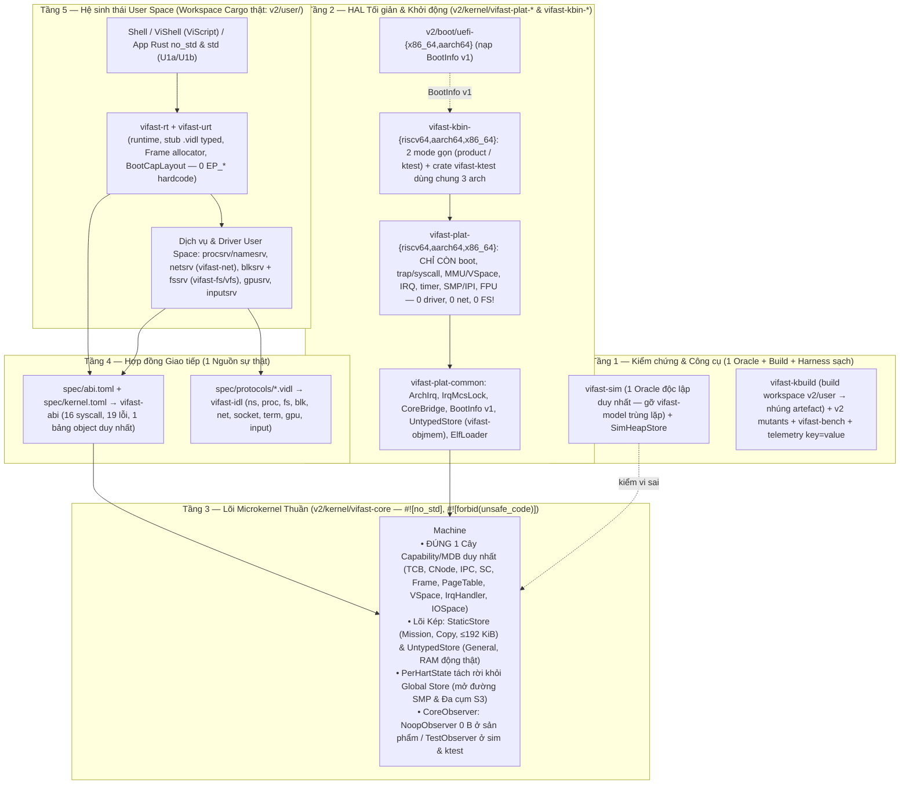

# KẾ HOẠCH ĐẠI TU & PHÁT TRIỂN KIẾN TRÚC VIFASTOS (`KT-400..KT-424` + `KT-401b/402b/414b`, 28 task ≤ 3 h)

**Người ban hành**: **Agent 0** (theo chỉ đạo trực tiếp của người điều phối, **D2-259** `2026-11-24`, hiệu đính **D2-260** `2026-11-25`).
**Trạng thái**: **HIỆU LỰC NGAY — KẾ HOẠCH DUY NHẤT ĐANG CHẠY.** Toàn bộ các kế hoạch phát hành trước đây (`v2.0`, `v2.1`, `KT-348`, Chu kỳ 2/3 cũ) đã được **huỷ bỏ hoàn toàn** và lưu trữ tại `v2/agent/archive/reports/`.
**Nguồn sự thật**: [`AGENTS.md`](AGENTS.md), [`v2/AGENTS.md`](v2/AGENTS.md), [`docs/QUYET-DINH-sau-review.md`](docs/QUYET-DINH-sau-review.md), [`v2/agent/DECISIONS.md`](v2/agent/DECISIONS.md) (**D2-259**, **D2-260**), [`v2/agent/QUEUE.md`](v2/agent/QUEUE.md).
**Nhãn số liệu (QD §2.2 & §9 Q12)**: mọi hằng số thiết kế/ngân sách trong kế hoạch này mang nhãn `[TK]` (mặc định), giả thuyết `[GT]`, ước lượng `[ƯL]`; tuyệt đối không chứa số đo hiệu năng viết tay.

> **Tuyên ngôn chỉ đạo (`D2-259`)**: **Bỏ toàn bộ áp lực phát hành (`v2.0` / `v2.1` / tag / báo cáo phát hành / soak nghìn boot trên nền cũ).** Tập trung **100 % vào tái cấu trúc và hoàn thiện kiến trúc Microkernel sạch, minh bạch, dễ mở rộng và dễ phát triển** — được phép refactor lại từ gốc miễn giữ vững kỷ luật kiểm chứng kỹ thuật (`T0`/`T1`/`T2`, test đỏ-trước, đột biến có răng, `forbid(unsafe_code)`, không nới ngưỡng, không retry `D2-07`, không GitHub Actions `D2-241`, vận hành theo lịch giờ DeepSeek `D2-256`).

---

## 1. Kiến trúc Đích 5 tầng (Rõ ràng — 1 Nguồn sự thật — 0 Nhân bản)

Mọi task trong kế hoạch này đều phục vụ trực tiếp việc đưa cây mã về đúng **Kiến trúc Đích 5 tầng** dưới đây — chấm dứt dứt điểm **11 nút thắt** đã đo được trên mã nguồn:



### Bảng 11 nút thắt gốc được giải quyết triệt để

| # | Nút thắt hiện tại (đo trực tiếp từ mã nguồn) | Giải pháp đích trong kế hoạch mới | Task xử lý |
|---|---|---|---|
| **1** | **2 Object/Capability Layer tách đôi trong kernel**: `vifast-core` (`[limits.core]`) vs `vifast-plat-common::obj` (`[limits.plat]`, ~2,4k LOC) | Hợp nhất về **1 cây Capability/MDB duy nhất trong `vifast-core`** (cả TCB/IPC lẫn `Frame`/`PageTable`/`VSpace`/`IrqHandler`/`IOSpace`), xóa bỏ hoàn toàn bảng `objects`/`caps`/`untypeds` thứ hai của `plat-common::obj` | `KT-416` → `KT-417` |
| **2** | **Driver & dịch vụ phình trong kernel (`B1`)**: `3.567` LOC dịch vụ FS/Net/Exec ở `kbin-riscv64` + cả 3 `plat-*` phụ thuộc `vifast-virtio`/`vifast-net` | Khóa ratchet `check-api-boundary.py` ngay Đợt 1 (`B1.1`), sau đó tách dứt điểm **`netsrv` → `blksrv`/`fssrv` → `gpusrv`/`inputsrv`** ra User Space (`B1.2`); không hợp nhất adapter driver trong kernel (`B6`) | `KT-403` → `KT-419` → `KT-421..KT-423` |
| **3** | **`v2/user/` chưa là workspace Cargo thật (`B4`)**: biên dịch thủ công từ 3 `build.rs` (`1.885` LOC lặp), không chạy `clippy`/`cargo test` dù `runtime/lib.rs` có `unsafe` | Biến `v2/user/` thành **Cargo workspace thật** (chạy `clippy` + `cargo test` trong `v2 check`); rút `vifast-kbuild` chỉ nhúng artefact đã build + đóng nợ `N-7` P20 | `KT-404` |
| **4** | **Trộn lẫn trạng thái sản phẩm & dữ liệu Oracle/Test trong `Machine`/`TcbData`**: `pair_hits[121]`, `finalise_log[256]`, `IpcArea`, `EndpointStats` làm `TcbData = 824 B > 512 B` của ABI | Tách **`CoreObserver`** (`NoopObserver` 0 B ở sản phẩm / `TestObserver` ở sim+ktest) + tách thân ABI in-place (`TcbCore ≤ 496 B`, `EndpointCore ≤ 48 B`) khớp 100 % `spec/abi.toml` | `KT-405` → `KT-408` → `KT-410` |
| **5** | **Bảng tĩnh cố định khóa cứng `64 TCB / 256 Obj / 192 CNode slot` + 245 truy cập trực tiếp** | **Lõi Kép `Machine<S: KernelStore>`**: giữ `StaticStore` (`Mission`, `Copy`, `0 unsafe`, `Meta == 48 B`) + mở `UntypedStore` (`General`, đặt body & slot vào `Untyped` qua `vifast-objmem` + `BootInfo` Arena phủ đủ 100 % bảng) | `KT-405` → `KT-408` → `KT-410` |
| **6** | **Big Kernel Lock (`IrqMcsLock<Machine>`) toàn cục cản SMP & IRQ** | Tách cấu trúc **`PerHartState`** (`sched`, `published`, `mail`, `tlb_pending`) khỏi Global Store ngay từ đầu + đo định lượng tranh khóa 4 hart bằng `vifast-bench` làm ngưỡng mở khóa theo hart / đa cụm `S3` | `KT-405` → `KT-412`/`413` → `KT-415` |
| **7** | **16 hằng số `EP_*` hardcode rải rác giữa kernel & userland** | Thay bằng **`BootCapLayout`** tối giản (`SELF_TCB`, `SELF_CSPACE`, `NS_EP`) + `namesrv`/`procsrv` cấp cap dịch vụ động qua 6 `.vidl` chuẩn | `KT-416` → `KT-420` |
| **8** | **3 mô hình kernel song song (`B2`)**: `vifast-core`, `vifast-sim`, `vifast-model` | Chốt đúng **2 thực thể**: `vifast-sim` = oracle độc lập so vi sai, `vifast-core` = sản phẩm; **gỡ/gộp `vifast-model`** ngay khi có `SimHeapStore` | `KT-410` |
| **9** | **Test trong kernel phân mảnh (`B5`) & `kbin-riscv64` 14 `[[bin]]` (`32,7k` LOC)** | Rút crate **`vifast-ktest`** generic theo trait `Platform` dùng chung 3 arch + gom `kbin-riscv64` về 2 mode (`product`/`ktest`, `< 16.000` LOC) đồng nhất `a64`/`x64` | `KT-411` |
| **10** | **HAL lặp + phụ thuộc ngược (`plat-common` dev-dep `plat-{a64,x64}`) + Sv39/PLIC nằm lẫn trong `plat-common`** | Đưa `TableMemory` lên `vifast-pte`, dời Sv39/PLIC sang `plat-riscv64`, rút `ArchIrq`/`IrqMcsLock`/`CoreBridge`/`ElfLoader` vào `plat-common` (`−≥ 3.500` LOC) | `KT-409` |
| **11** | **Kho nặng rác v1 (~62 % dung lượng), 2 `Cargo.lock` (`B3`), tooling ~53k LOC + regex log giòn** | Gỡ cây v1 & archive rác ngay Đợt 1 (`Cargo.toml` gốc → `v2/`); thêm checker đồng bộ 2 `Cargo.lock`; thay 43 `mut-*` bằng `v2 mutants`; chuẩn hóa telemetry `key=value`; tách `check-wake-paths.py` & đồng bộ `rc=126`/Linux `LD_PRELOAD` | `KT-400`, `KT-403`, `KT-406`, `KT-407` |

---

## 2. Nguyên tắc vận hành cho chương trình Đại tu (không có gánh nặng phát hành)

1. **Tập trung kiến trúc, KHÔNG chạy soak phát hành lãng phí**: bỏ hoàn toàn `KT-348`, báo cáo `R2-v2`, tag `v2.0`/`v2.1` và các đợt soak nghìn boot trên nền kiến trúc cũ đang bị thay thế.
2. **Giữ vững kỷ luật an toàn khi refactor mạnh**:
   - Mọi task `≤ 3 h`, mã task `^KT-[0-9]+[a-z]?$` (`KT-400..KT-424`), **0 % chồng chéo tệp** giữa các slot chạy song song trong cùng một đợt.
   - Sub-agent chỉ chạy **T0 (`v2 t0`) + T1 (`v2 gate --dev`)** ở Giờ Thấp điểm DeepSeek (`0,5×`); Lead gom lô chạy **T2 (`v2 gate --fast`) + `L1-medium` + Miri + `v2 mutants` + `vifast-bench`** ở Giờ Cao điểm (`2×`, 0 token LLM, `D2-256`).
   - Không nới ngưỡng, không retry `D2-07`, không GitHub Actions `D2-241`, giữ cứng `spec/` cho tới đúng 1 cửa sổ duy nhất **`KT-417`** (sau khi `KT-416` được Agent 0 `APPROVED`).
   - Trước `KT-417`: bảo toàn đường dẫn & tên hằng trong `spec/kernel.toml` (`machine.rs` tệp cha, `plat-common/src/obj/mod.rs`, `gdt.rs`, `GOI-ABI-V1_1.md`) để `check_kernel.py` luôn xanh.

---

## 3. Đồ thị Sóng thi công 0 % chồng chéo tệp (`KT-400..KT-424` + `KT-401b/402b/414b` — 4 Chặng, 10 Đợt)

```text
[BẮT ĐẦU NGAY — BỎ TOÀN BỘ KẾ HOẠCH PHÁT HÀNH CŨ (D2-259, hiệu đính D2-260)]
  │
  ═══════════════════════════════════════════════════════════════════════════════
  CHẶNG 0 — DỌN SẠCH MẶT BẰNG, KHÓA RATCHET & CHUẨN HÓA BUILD/USER WORKSPACE
  ═══════════════════════════════════════════════════════════════════════════════
  ▼ ĐỢT W1 [Thấp điểm 0,5× | 0 chồng tệp | 0 sửa spec/]
  ├── [Slot 1 — Dọn Kho]        KT-400 [DONE] (Gỡ cây v1 crates/legacy/scripts + archive JOURNAL/bundles giữ GOI-ABI-V1_1.md + Cargo.toml gốc → v2)
  ├── [Slot 2 — Xả R1 & ELF]    KT-401 [READY] (Xả R1 5 tệp <950 + biên ELF rv 32 KiB + .corespace NOLOAD rv + NBSend 1 luật — Lead gộp asm.rs + T2)
  ├── [Slot 3 — BootInfo]       KT-402 [DONE] (BootInfo v1 dùng chung 3 arch + parse DTB thật rv/a64 + ACPI MADT/FADT/E820 x64)
  └── [Slot 4 — Ratchet/Đo]     KT-403 [DONE] (B1.1 Ratchet + 24/24 v2 mutants gỡ 43 mut-* + telemetry key=value + trace 32 B + vifast-bench smoke)
  │
  ▼ ĐỢT W2 [Thấp điểm 0,5× | 0 chồng tệp | 0 sửa spec/]
  ├── [Slot 1 — User Workspace] KT-404 (B4: Cargo workspace thật v2/user/ qua clippy+test + crate host vifast-kbuild + đóng N-7 P20 + 9 crate forbid_unsafe)
  ├── [Slot 2 — Tiền đề Lõi]    KT-405 (CoreObserver 0 B + PerHartState + intrusive ready queue + 245 accessor + TcbCore/EndpointCore + dọn 15 lint clippy core)
  ├── [Slot 3 — UART & Linux]   KT-406 [DONE] (UART RX IRQ thật PL011/COM1 + runner product-{a64,x64}.sh + nhánh LD_PRELOAD Linux)
  ├── [Slot 4 — Tools & B3]     KT-407 [READY] (v2/tools/* + tách wake/parity + run-common.sh + vá guard_selftest case 9 + B3 lockfile + .scn 3 arch)
  └── [Slot 5 — W^X 3 Arch]     KT-401b (D2-260: W^X 4 KiB toàn ảnh riscv64 + x86_64 PD[1..] PTE_NX + aarch64 .corespace NX probe & đột biến)
        └──► [Cao điểm: Lead gộp lô + nối caller v2/bin/lib/ + T2 + L1-medium]
  │
  ═══════════════════════════════════════════════════════════════════════════════
  CHẶNG 1 — LÕI KÉP ĐA HÌNH (KernelStore), HAL SẠCH & SUITE TEST CHUNG (vifast-ktest)
  ═══════════════════════════════════════════════════════════════════════════════
  ▼ ĐỢT W3 [Thấp điểm 0,5× | 3 Slot song song | 0 chồng tệp | 0 sửa spec/]
  ├── [Slot 1 — Trait Lõi Kép]  KT-408 (KernelStore + Machine<S=StaticStore, O> Copy ≤184.832 B + ring trace 32 B kernel D2-09/pmemsave)
  ├── [Slot 2 — HAL & Clippy]   KT-409 (Đại tu plat-common + dời Sv39/PLIC sang rv + TableMemory lên pte + nối clippy kernel vào steps_check.sh)
  └── [Slot 3 — BootInfo 3A]    KT-402b (Đóng nợ harness KT-402: aarch64 -dtb thật + x86_64 fw_cfg/table-loader + ca âm bảng hỏng 3 arch)
        └──► [Cao điểm: Lead gộp lô + T2 + L1-medium]
  │
  ▼ ĐỢT W4 [Thấp điểm 0,5× | 4 Slot song song | 0 chồng tệp | 0 sửa spec/]
  ├── [Slot 1 — General & B2]   KT-410 (UntypedStore bọc vifast-objmem + BootInfo Dynamic Arena ≥512 TCB + SimHeapStore + B2 chốt 2 mô hình & gỡ vifast-model)
  ├── [Slot 2 — ktest & RV]     KT-411 (B5: Crate vifast-ktest generic đa arch + gom kbin-riscv64 14 [[bin]] → 2 mode product[mission/general]/ktest <16k LOC)
  ├── [Slot 3 — UEFI x86_64]    KT-414 [READY] (v2/boot/uefi-x86_64 qua OVMF + BootSource::Uefi trong BootInfo v1 + rsdp_pa/dtb_pa + --firmware uefi x64)
  └── [Slot 4 — UEFI aarch64]   KT-414b (v2/boot/uefi-aarch64 qua AAVMF + semihosting/PSCI + đồng bộ target UEFI rustc 1.100.0)
        └──► [Cao điểm: Lead gộp lô + T2 + L1-medium 40k + Miri]
  │
  ═══════════════════════════════════════════════════════════════════════════════
  CHẶNG 2 — SMP 4 HART 3 ARCH, HỢP NHẤT 1 CÂY CAPABILITY DUY NHẤT & ABI SẠCH
  ═══════════════════════════════════════════════════════════════════════════════
  ▼ ĐỢT W5 [Thấp điểm 0,5× | 2 Slot song song | 0 chồng tệp | 0 sửa spec/]
  ├── [Slot 1 — SMP RV & A64]   KT-412 (SMP preemptive 4 hart riscv64 & aarch64 qua CoreBridge/PerHartState + bộ test SMP chung vifast-ktest)
  └── [Slot 2 — SMP X86_64]     KT-413 (SMP preemptive 4 hart x86_64 qua CoreBridge/vifast-ktest + gỡ sạch 2.162 LOC sched.rs + PCID/ASID + đóng N-3 watchdog LAPIC)
  │
  ▼ ĐỢT W6 [Thấp điểm 0,5× | 2 Slot song song | 0 chồng tệp | 0 sửa spec/]
  ├── [Slot 1 — SMP Tầng 2]     KT-415 (Mailbox<N> + cờ OVERFLOW trên IpiMailbox + VSpace::free_frame/range shootdown + vifast-bench đo tranh khoá Big Kernel Lock 4 hart)
  └── [Slot 2 — RFC Tổng thể]   KT-416 (RFC GOI-ABI-KIEN-TRUC.md 8 nhóm: Hợp nhất 2 Cap Layer xóa [limits.plat], IRQ/MapIo/IOSpace, Tcb.Exec, syscall/sysret, BootCapLayout — chờ A0 APPROVED)
        └──► [Cao điểm: Lead T2 + vifast-bench 4 hart + Agent 0 thẩm định & ghi APPROVED cho KT-416]
  │
  ▼ ĐỢT W7 [Thấp điểm 0,5× — chỉ mở KT-417 sau APPROVED A0 | 2 Slot song song | 0 chồng tệp]
  ├── [Slot 1 — 1 Cây Cap]      KT-417 (Áp spec/ + Hợp nhất 1 Cây Capability/MDB duy nhất vào vifast-core [xóa bảng thứ hai plat-common::obj!] + x86_64 syscall/sysret → khóa lại spec/)
  └── [Slot 2 — Bảo mật & FPU]  KT-418 (SEC-1: FPU/SIMD eager theo TCB ngoài TcbCore + SMEP/SMAP/PAN/SUM + virtio-rng + fuzz vifast-net)
  │
  ═══════════════════════════════════════════════════════════════════════════════
  CHẶNG 3 — MICROKERNEL ĐÚNG NGHĨA: ĐẨY SẠCH DRIVER & DỊCH VỤ RA USER SPACE (B1.2)
  ═══════════════════════════════════════════════════════════════════════════════
  ▼ ĐỢT W8 [Thấp điểm 0,5× | 2 Slot song song | 0 chồng tệp]
  ├── [Slot 1 — Driver Infra]   KT-419 (IrqControl/IrqHandler + Notification + Frame.MapIo + IOSpace IOMMU virtio-iommu/VT-d/SMMUv3 cô lập DMA 3 arch, thoát busy-poll)
  └── [Slot 2 — User Space]     KT-420 (BootCapLayout thay 16 EP_* hardcode + namesrv/procsrv + 6 .vidl chuẩn + vifast-rt U1a-Full cấp trang Frame/Untyped + Tcb.Exec(path) 3 arch)
  │
  ▼ ĐỢT W9 [Thấp điểm 0,5× | 3 Slot song song | 0 chồng tệp (Lead dọn Cargo.toml lúc merge)]
  ├── [Slot 1 — B1.2 Mạng]      KT-421 (Tách netsrv + virtio-net 100 % ra v2/user/ + TCP socket.vidl + ping/ifconfig → GỠ sạch vifast-net/net_svc/proc_net/tcp khỏi kernel & siết ratchet!)
  ├── [Slot 2 — B1.2 Đĩa/FS]    KT-422 (Tách blksrv + fssrv 100 % ra v2/user/ qua blk.vidl/fs.vidl + IOSpace → GỠ sạch proc_fs/virtio_blk/vifast-fs/vfs khỏi kernel & siết ratchet!)
  └── [Slot 3 — B1.2 GPU/NVMe]  KT-423 (Tách gpusrv + inputsrv ra v2/user/ + PCIe MSI-X & NVMe U-mode → GỠ sạch virtio_*/vifast-virtio khỏi plat-*! plat-* chỉ còn trap/MMU/IRQ/timer/SMP/FPU!)
  │
  ▼ ĐỢT W10 [Thấp điểm + Cao điểm kiểm định kiến trúc — KHÔNG soak phát hành]
  └── [Chốt Kiến trúc Sạch]     KT-424 (Port ViShell/ViScript + PoC Rust std PAL U1b trên kiến trúc mới + kiểm toán kiến trúc: T2 + L1-medium 40k 2 Store + Miri + v2 mutants + vifast-bench)
```

---

## 4. Bảng đặc tả chi tiết 28 task (`KT-400..KT-424` + `KT-401b/402b/414b`, mọi task ≤ 3 h)

### Chặng 0 — Dọn mặt bằng, Khóa Ratchet & Chuẩn hóa Build/User Workspace (Đợt W1 & W2)

| Mã | Ưu tiên | Task | Phụ thuộc | Ngân sách | Tiêu chí xong (DoD) & Ranh giới tệp |
|---|---|---|---|---|---|
| **KT-400** | P0 | **Tinh gọn Kho dứt điểm (gỡ cây v1, archive rác, `Cargo.toml` gốc → `v2/`)** | — | 2 h | (1) Archive ~1.120 tệp rác Chu kỳ 1 không phải `.md` trong `v2/agent/JOURNAL/` (giữ `summary.txt`, `scope=`, `counters.toml`, liên kết sống) vào tag annotated **`cycle1-raw-artifacts`**; (2) archive `docs/bundles/` (`12 MiB`) & 29 tệp lịch sử `review/` vào tag annotated **`docs-bundles-archive`** (**BẮT BUỘC giữ nguyên `review/agent0/GOI-ABI-V1_1.md`**, `docs/v1/` đọc-only §4.7, `docs/QUYET-DINH-sau-review.md`, `docs/v2/ViFastOs-v2-thiet-ke.md` §4.6); (3) gỡ cây mã v1 đóng băng (`crates/`, `legacy/`, `deploy/`, `python-model/`, `scripts/` — bất biến tại tag `v1-archive`), sửa fixture `case-r4-path-dep`, dọn `README.md`, đổi `Cargo.toml` gốc trỏ workspace `v2/` (cắt ~62 % dung lượng & ~50 % số tệp); `check_kernel.py` + `verify-numbers.py` (`ok=5 fail=0`) + T2 PASS. |
| **KT-401** | P0 | **Xả R1 5 tệp nóng `< 950` LOC (giữ `machine.rs` cha) + Biên ELF `riscv64` 32 KiB + `NBSend` một luật + `.corespace` NOLOAD `riscv64`** | — | 3 h | (1) Tách 5 tệp nóng `< 950` LOC: `core_ipc.rs` + `core_ipc/{send,recv,reply,queue}.rs`, **`machine.rs` (giữ tệp cha chứa `MAX_*` cho `check_kernel.py`)** + `machine/{init,lifecycle}.rs`, `core_tcb.rs` + `core_tcb/*.rs`, `plat-x86_64/src/asm.rs` + `asm/{trap,syscall,fpu}.rs`, `v2/user/programs/shell.rs` (L1 digest trùng 100 %); (2) mở biên ELF user `riscv64` (`USER_STACK_TOP = 0x4010_0000`, `MAX_INIT_PAGES = 32`, `MAX_ELF_BYTES = 40 KiB`, fixture 32 KiB `child_big=1`, cập nhật 2 ghim `guard=0x400f7000` ở `ktest.sh:647,830`); (3) đồng bộ **`NBSend` `keep_committed` một luật cho mọi đường** (`D2-260` mục 1) + parity sim + TAP 9 `drained >= 1`; (4) đưa `Machine` `riscv64` sang `.corespace` NOLOAD; phần W^X NX 3 arch tách sang `KT-401b`; T2 PASS. |
| **KT-401b** | P0 | **W^X 4 KiB toàn ảnh `riscv64` + `.corespace` NX đủ 3 arch (`D2-260` mục 2)** | `KT-401` | 3 h | (1) `riscv64`: chuyển ảnh kernel `[0x8020_0000, __hart_area_base)` từ lá 2 MiB RWX sang **4 KiB theo đoạn W^X** (`.text` RX, `.rodata` R NX, `.data`/`.bss`/`.corespace` RW NX ở identity + nửa cao), thay ghim `kernel_high_2m=1` (`ktest.rs:456`, `ktest.sh:534-535`) bằng bằng chứng W^X 4 KiB (`kernel_wx_4k=1` + `.corespace` NX = 1 + đột biến thực thi/bỏ NX ĐỎ), giữ nguyên biên guard user `0x400f7000`; (2) `x86_64`: đóng nợ `KT-341` §7.3 — bật `PTE_NX` cho `PD[1..512]` (phủ `.corespace` sau mốc 2 MiB) trong `wx::enable`, đọc lá `__corespace_start` trong `WxReport`/TAP + đột biến ĐỎ; (3) `aarch64`: xác minh PTE `PXN=1, UXN=1` trên `__corespace_start` + đột biến ĐỎ; 0 sửa `spec/`, không nới trần `.data+.bss`; T2 PASS. |
| **KT-402** | P0 | **HW-0a: `BootInfo` v1 dùng chung 3 arch + DTB thật (`rv`/`a64`) + ACPI `MADT`/`FADT`/E820 (`x64`)** | — | 3 h | Định nghĩa struct có phiên bản `BootInfo` v1 dùng chung 3 arch (bản đồ vùng RAM usable, `N_harts` thật, địa chỉ PLIC/GIC/APIC/UART/PCIe ECAM); parse FDT/DTB từ `kmain(dtb)` trên `riscv64`/`aarch64` và `MADT`/`FADT`/E820 trên `x86_64` thay hằng cứng QEMU (fail-closed có tên khi bảng hỏng); cô lập trong mô-đun mới (**0 chạm `asm.rs`, UART hay `vifast-core`**); nợ harness `a64 -dtb` + `x64 fw_cfg` tách sang `KT-402b`; T2 PASS. |
| **KT-402b** | P1 | **Đóng nợ harness `KT-402`: `aarch64 -dtb` thật + `x86_64 fw_cfg/table-loader` + ca âm bảng hỏng 3 arch (`D2-260` mục 5)** | `KT-402, KT-407` | 2 h | (1) `aarch64`: runner truyền DTB thật (`-machine dumpdtb=…` + `-dtb`) để `plat-aarch64::bootinfo::detect` chạy thật `parse_fdt` thay `absent src=dtb` + ca âm DTB hỏng `fail-closed` halt exit 9; (2) `x86_64`: hoàn thiện nhánh fallback `fw_cfg` (`etc/acpi/tables` + `etc/table-loader`) khi thiếu RSDP SeaBIOS, đồng bộ chú thích `bootinfo.rs`, kiểm `# bootinfo: v=1` + ca âm; (3) `riscv64`: kiểm `# bootinfo: v=1` trên runner; chỉ chạm `plat-{aarch64,x86_64}/src/bootinfo.rs` + `v2/test/boot/{run-aarch64,run-x86_64,ktest}.sh`; T2 PASS. |
| **KT-403** | P0 | **Khóa Ratchet kiến trúc (`B1.1`) + `v2 mutants` (gỡ 43 `mut-*`) + Telemetry `key=value` + `vifast-bench`** | — | 2 h | (1) Thêm luật **ratchet (`B1.1`)** vào `check-api-boundary.py` (kèm ca âm đỏ-trước): cấm `vifast-core`/`vifast-plat-*` thêm dep mới sang `vifast-net`/`vifast-fs`/`vifast-vfs` và đóng băng danh sách tệp driver `virtio_*`/`tcp`/`*_svc` hiện có trong kernel (chỉ được phép giảm, cấm tăng); (2) dựng `v2/test/mutants.toml` + `v2 mutants` gỡ sạch 43 `mut-*` + nối `v2 nightly --all`; (3) `vifast-trace` 32 B (`VFT1`) + `vifast-sim --trace-bin` + quy chuẩn parser telemetry `key=value` + `vifast-bench --smoke` (`-icount`); ring trace kernel chuyển `KT-408` (`D2-260` mục 3); T2 PASS. |
| **KT-404** | P0 | **Workspace Cargo thật cho `v2/user/` (`B4`) + Crate host `vifast-kbuild` + Đóng `N-7` P20 + 9 crate `forbid(unsafe_code)`** | `KT-400, KT-401` | 3 h | (1) Biến `v2/user/` thành **Cargo workspace độc lập** (`vifast-urt`, `vifast-rt`, các `[[bin]]` chương trình), nối `cargo clippy` + host unit test cho `v2/user/` vào `steps_check.sh` (khép lỗ hổng `unsafe` ở `runtime/lib.rs` không bị `clippy`!); (2) rút crate host `v2/kernel/vifast-kbuild` (`#![forbid(unsafe_code)]`, 0 dep ngoài) cắt 3 `build.rs` từ `1.885 → ~450` LOC — chỉ build/nhúng artefact ELF từ workspace `v2/user/`; (3) điều tra & đóng dứt điểm nợ **`N-7`** của `KT-348a` (cả `inputs` lẫn `.text` digest P20 khớp 100 % xuyên thư mục 3 arch); (4) bật `#![forbid(unsafe_code)]` cho 9 crate 0-`unsafe`; 0 chạm `vifast-core` hay `src/` `plat-common`; T2 PASS. |
| **KT-405** | P0 | **Tiền đề Lõi Thuần: Tách `CoreObserver` (0 B ở sản phẩm) + `PerHartState` + Intrusive Ready Queue + 245 accessor + `TcbCore`/`EndpointCore` + dọn clippy `vifast-core`** | `KT-401` | 3 h | Chỉ chạm `v2/kernel/vifast-core/src/` (`#![forbid(unsafe_code)]`, 0 đổi API công khai 3 arch, 0 sửa `spec/`): (1) rút toàn bộ dữ liệu oracle/test (`pair_hits`, `forbidden_hits`, `finalise_log`, `EndpointStats`, `IpcArea` mô phỏng) sau **`trait CoreObserver`** (`NoopObserver` 0 B cho sản phẩm / `TestObserver` cho sim+ktest); (2) tách **`PerHartState`** (`sched`, `published`, `mail`, `tlb_pending`) khỏi sổ cái object (mở đường bỏ Big Kernel Lock / đa cụm `S3`); (3) chuyển ready queue sang danh sách xâm nhập (`sched_prev`/`sched_next`) và tách thân ABI in-place **`TcbCore ≤ 496 B`**, **`EndpointCore ≤ 48 B`** (hàng gửi xâm nhập `send_head`/`send_tail`), `ScData ≤ 240 B`, `NotificationData 32 B`, `ReplyData 8 B` kèm `const` assert khớp `spec/abi.toml:159`; (4) gom toàn bộ **245 điểm truy cập mảng trực tiếp** của `Machine` về accessor/closure nội bộ; (5) **dọn sạch 15 cảnh báo `clippy -D warnings` có sẵn trong `vifast-core`** (`D2-260` mục 3); giữ `Meta == 48 B` và L1 digest trùng 100 %; T2 PASS. |
| **KT-406** | P1 | **HW-0b: UART RX IRQ thật (`PL011`/`COM1`) + Runner `product-{aarch64,x86_64}.sh` + Nhánh `LD_PRELOAD` Linux** | `KT-402` | 2 h | Bật ngắt UART RX thật (`PL011` `aarch64`, `COM1` `x86_64`) thay poll/script bơm kernel; thêm `product-{aarch64,x86_64}.sh` lái shell thật 3/3 arch; thêm nhánh `LD_PRELOAD` (`.so`) song song với Mach-O `.dylib` cho DNS interpose để test chạy trên cả Linux & macOS; 0 chạm `run-common.sh`; T2 PASS. |
| **KT-407** | P1 | **Đại tu Tooling, Parity, `run-common.sh`, vá `guard_selftest` case 9 & Đồng bộ Lockfile (`B3`)** | `KT-400, KT-403` | 3 h | (1) Tổ chức `v2/tools/{checkers,build,ops,crates}/` (Lead cập nhật caller `v2/bin/lib/` lúc merge); (2) tách `check-wake-paths.py` (11k LOC) thành package `checkers/wake/` (giữ 461/461 selftest); (3) tách 3 tệp parity `kt{58,59,60}_core_parity.rs` (`9.229` LOC); (4) rút `v2/test/boot/lib/run-common.sh` đồng bộ `rc=126` tín hiệu ngoài + `log_inventory` + 1 `trap EXIT` + `monitor-sendkey.py` trên mọi runner; (5) **vá T-INFRA `guard_selftest.sh` case 9 (`run_infra_orphan`)** so `after_ppid1 >= before_ppid1 + 1` + kiểm PID ca (`D2-260` mục 5); (6) thêm checker **`B3`** kiểm 2 `Cargo.lock` cùng phiên bản cho mọi crate dùng chung; chạy `.scn` conformance 3 arch; 0 chạm `v2/kernel/` hay `v2/user/`; T2 PASS. |

### Chặng 1 — Lõi Kép Đa hình (`KernelStore`), HAL Sạch & Suite Test Chung `vifast-ktest` (Đợt W3 & W4)

| Mã | Ưu tiên | Task | Phụ thuộc | Ngân sách | Tiêu chí xong (DoD) & Ranh giới tệp |
|---|---|---|---|---|---|
| **KT-408** | P0 | **Trait an toàn `KernelStore`, `ViFastOs-Mission` (`Machine<S=StaticStore, O>`) & Ring Trace 32 B kernel (`D2-09`)** | `KT-405` | 3 h | Định nghĩa trait closure an toàn `KernelStore` trong `vifast-core/src/store.rs` (`#![forbid(unsafe_code)]`, 0 dep ngoài) phủ đủ 100 % bảng (`Meta`, `Cap`, `Region`, `Slot`, 5 thân ABI, `QueuedMsg`, `WaitNode`/`AddrWord`/`wait_buckets`, `PerHart`); tham số hóa `pub struct Machine<S: KernelStore = StaticStore, O: CoreObserver = TestObserver>` (và `MissionMachine = Machine<StaticStore, NoopObserver>`) giữ `#[derive(Clone, Copy)]`, `size_of::<Meta>() == 48 B`, `≤ 184.832 B`, thêm `Machine::set_harts(n)`, giữ nguyên `machine.rs#MAX_*` (`check_kernel.py` xanh, 0 sửa 3 arch); **nối ring trace 32 B luôn bật (`FixedRing`, `D2-09`, chuyển từ `KT-403`) vào `PerHartState`/`.corespace` NOLOAD** (0 tăng `.data+.bss`) + bằng chứng `pmemsave` giải mã bằng `vifast-trace`; 3 đột biến đỏ + `L1-medium` 10k + T2 PASS. |
| **KT-409** | P0 | **Đại tu HAL `vifast-plat-common` (Gỡ dev-dep ngược + Dời Sv39/PLIC sang `plat-riscv64`) + Nối cổng `clippy` kernel** | `KT-404` | 3 h | (1) Rút vào `vifast-plat-common` các khối dùng chung 3 arch: `ArchIrq`, `IrqMcsLock<T, A>`, `CoreBridge<A>`, `ElfUserLoader`, `ProductShellHost`, `ImageHash`/`WxReport` (giữ tạm `obj/mod.rs` + 5 hằng `MAX_*` tới `KT-417`; **KHÔNG** hợp nhất adapter driver `virtio_*` theo `B6`); (2) dời toàn bộ Sv39/PLIC/trap/timer/tlb/user sang `vifast-plat-riscv64` (`0` từ khóa đặc thù RISC-V trong `plat-common`); (3) đưa `TableMemory` lên `vifast-pte` và **xóa dev-dependency ngược** sang `plat-aarch64`/`plat-x86_64` trong `plat-common/Cargo.toml`; (4) **dọn sạch cảnh báo `clippy -D warnings` ở `plat-*` và nối bước `clippy` host-testable cho `v2/kernel/` vào `steps_check.sh`** (`D2-260` mục 3); cắt giảm ≥ `3.500` LOC lặp; 0 chạm `vifast-core`; T2 PASS. |
| **KT-410** | P0 | **Chế độ `ViFastOs-General` (`UntypedStore` + `BootInfo` Arena) + `SimHeapStore` + Gỡ `vifast-model` (`B2`)** | `KT-402, KT-408, KT-409` | 3 h | (1) Cài `UntypedStore` trong `vifast-plat-common/src/untyped_store.rs` + `vifast-objmem` (sẵn trong allowlist R5 `util.sh:206`): đặt `TcbCore`/`EndpointCore`/`ScData`/`NotificationData`/`ReplyData` + slot `CNode` 48 B trực tiếp trong `Untyped` qua `physmap`, cắt `BootInfo` Dynamic Arena cho toàn bộ bảng mở rộng (`MetaDyn` 32-bit, `Cap`, `regions`, `ipc_msgs`, `wait_nodes`, `addr_words`, `wait_buckets`); (2) cài `SimHeapStore` chạy vi sai trực tiếp trên `vifast-core`; (3) chốt quyết định **`B2`**: chỉ giữ 2 mô hình (`vifast-sim` oracle độc lập + `vifast-core` sản phẩm), **gộp/gỡ crate trùng lặp `vifast-model`**; chứng minh trên cùng mã lõi: `StaticStore` chặn TCB 65 còn `UntypedStore` tạo & `Revoke` sạch **≥ 512 TCB / ≥ 1.024 Cap** trả watermark về 0; `L1-medium` 40k + Miri + T2 PASS. |
| **KT-411** | P0 | **Crate `vifast-ktest` generic đa arch (`B5`) & Gom `kbin-riscv64` (14 `[[bin]]` → 2 mode)** | `KT-408, KT-409` | 3 h | (1) Tạo crate **`v2/kernel/vifast-ktest`** generic theo trait `Platform`/`CoreBridge` của `plat-common` để 3 arch dùng chung 1 bộ test core/IPC/VM/SMP thay vì bảo trì 3 bộ riêng (`coretest.rs` & 30 `ktest_*.rs`); (2) gom `vifast-kbin-riscv64` (`32.7k` LOC / 14 `[[bin]]`) về đúng 2 mode `product` (chọn profile `mission`/`general`) và `ktest` (`< 16.000` LOC) đồng nhất 100 % với `aarch64`/`x86_64`; giữ đủ độ phủ matrix & parity; T2 PASS. |
| **KT-414** | P1 | **UEFI Boot `x86_64` (`v2/boot/uefi-x86_64` qua `OVMF`) + `BootSource::Uefi` (`BootInfo` v1) (`D2-260` mục 4)** | `KT-402` | 3 h | Hoàn tất `v2/boot/uefi-x86_64` (sẵn R5 `util.sh:206`), boot qua `OVMF` (`--firmware uefi`), chụp memory map ngay trước `ExitBootServices`, nối **`BootSource::Uefi`** trong `BootInfo` v1 (giữ `BOOTINFO_VERSION = 1`, `validate()` fail-closed theo nguồn, bổ sung `rsdp_pa`/`dtb_pa` trong `UefiHandoffV1`) mà không đổi đường `-kernel`; ca âm bảng nhớ hỏng fail-closed; phần `aarch64` tách sang `KT-414b`; T2 PASS. |
| **KT-414b** | P1 | **UEFI Boot `aarch64` (`v2/boot/uefi-aarch64` qua `AAVMF`) & đồng bộ target UEFI trên `rustc 1.100.0` (`D2-260` mục 4)** | `KT-414` | 3 h | Tiền đề hạ tầng máy đo: cài 1 lần `x86_64-unknown-uefi` + `aarch64-unknown-uefi` trên toolchain `1.100.0`. Dựng `v2/boot/uefi-aarch64` tái dùng mô-đun chung `efi/memmap/handoff`, boot qua `AAVMF` (`-semihosting` hoặc `PSCI SYSTEM_OFF`), nạp `UefiHandoffV1` + `BootSource::Uefi`, bỏ fallback `stable`, nối `--firmware uefi` `aarch64` (0 đổi `-kernel`), ca âm fail-closed; T2 PASS. |

### Chặng 2 — SMP 4 Hart 3 Arch, Hợp nhất 1 Cây Capability Duy nhất & ABI Sạch (Đợt W5, W6 & W7)

| Mã | Ưu tiên | Task | Phụ thuộc | Ngân sách | Tiêu chí xong (DoD) & Ranh giới tệp |
|---|---|---|---|---|---|
| **KT-412** | P0 | **SMP Preemptive 4 hart trên `riscv64` & `aarch64` (trên `CoreBridge` + `vifast-ktest` chung)** | `KT-402, KT-402b, KT-411` | 3 h | Kích hoạt `Machine::set_harts(n)` từ `BootInfo` thật (`KT-402b`) + `PerHartState` trên `riscv64` & `aarch64`; 4 hart đồng thời chạy tác vụ U-mode preemptive qua timer trên nền `CoreBridge<A>` chung (`0` starvation, `0` double-pick, đúng luật đọc `published` §4.16); nối bộ ca SMP chung của `vifast-ktest` chạy giống hệt nhau trên cả 2 arch; 3 đột biến đỏ; 0 chạm `x86_64`; T2 PASS. |
| **KT-413** | P0 | **SMP Preemptive 4 hart `x86_64` + Gỡ bỏ 2.162 LOC harness `sched.rs` + PCID/ASID + Đóng `N-3`** | `KT-402, KT-402b, KT-411` | 3 h | Đưa cả 4 hart `x86_64` vào `vifast-core` qua `CoreBridge` + bộ ca SMP chung `vifast-ktest`; **xóa sạch 2.162 dòng harness `sched.rs` tự viết** (`KT-340e`); bật & kiểm `PCID`/`ASID` khi CPU hỗ trợ; đóng nợ **`N-3`** của `KT-348a` (thêm watchdog LAPIC/vector riêng để `hlt` không bao giờ ngủ vô hạn nếu mất IRQ0); 0 chạm `riscv64`/`aarch64`; T2 PASS. |
| **KT-415** | P0 | **SMP Tầng 2 (`Mailbox<N>` + `OVERFLOW` trên `IpiMailbox`) + `VSpace::free_frame`/range shootdown + Đo tranh khóa `vifast-bench`** | `KT-412, KT-413` | 3 h | Cài `vifast_sync::Mailbox<N>` tầng 2 trên `IpiMailbox` kèm cờ `OVERFLOW` tự rơi về full-rescan/full-flush (bảo đảm toán học 0 mất đánh thức); bổ sung `VSpace::free_frame`/`destroy` + range TLB shootdown đa yêu cầu 3 arch; đo định lượng tỷ lệ chờ khóa Big Kernel Lock trên 4 hart bằng `vifast-bench` (làm tiêu chuẩn kích hoạt khóa Per-Hart / đa cụm `S3`); 3 đột biến đỏ; T2 PASS. |
| **KT-416** | P0 | **RFC Hợp nhất Kiến trúc & ABI Sạch (`review/agent0/GOI-ABI-KIEN-TRUC.md`) — KHÔNG sửa `spec/`** | `KT-410, KT-412, KT-413` | 3 h | Soạn 1 gói thẩm định tổng thể duy nhất (8 nhóm) trình Agent 0 duyệt: **(1) Hợp nhất 2 Object/Cap Layer (`plat-common::obj` → `vifast-core`: 1 cây MDB/Capability duy nhất cho cả TCB/IPC lẫn `Frame`/`PageTable`/`VSpace`, xóa `[limits.plat]` khỏi `spec/kernel.toml`)**; (2) `IrqControl`/`IrqHandler` + `Notification`; (3) `Frame.MapIo`/`UnmapIo` + `IOSpace` (IOMMU); (4) `Tcb.Exec` + method `VSpace`/`PageTable`; (5) GDT `planned` (`sysret_ready = true`) cho `syscall`/`sysret` `x86_64` giữ `7C-r13`; (6) `CNode.Mutate`/`Rotate` + MCS refill đa đoạn (`D2-16`); (7) `[profiles]` `mission`/`general`, quy tắc `BootArena` & vùng lưu FPU/SIMD theo arch; **(8) Hợp đồng `BootCapLayout` tối giản thay thế 16 hằng `EP_*` hardcode**. **Chỉ mở `KT-417` sau khi Agent 0 ghi `APPROVED`.** |
| **KT-417** | P0 | **Áp `spec/` mới + Hợp nhất 1 Cây Capability/MDB duy nhất (Gỡ `plat-common::obj`) + Bật `x86_64` `syscall`/`sysret`** | `KT-415, KT-416` *(APPROVED A0)* | 3 h | (1) Áp chính xác các mục `APPROVED` ở `KT-416` vào `spec/abi.toml` & `spec/kernel.toml` (**xóa `[limits.plat]`**), sinh lại `vifast-abi`, kiểm `check_abi.py` + `check_kernel.py` + `vifast-gen --check`; (2) **hợp nhất toàn bộ `Frame`/`PageTable`/`VSpace` vào 1 cây MDB/Capability duy nhất của `vifast-core`** qua trait `ArchVmOps` và **xóa bỏ bảng `objects`/`caps`/`untypeds` thứ hai của `plat-common::obj`** (chứng minh `Revoke` 1 `Untyped` thu hồi sạch đồng thời TCB + `VSpace` + `Frame`!); (3) bật `x86_64` `syscall`/`sysret` (`swapgs` + GDT `planned` trên `asm/syscall.rs` & `gdt.rs`, giữ `7C-r13`); **khóa cứng lại `spec/`**; 0 đụng `asm/fpu.rs`; T2 PASS. |
| **KT-418** | P1 | **SEC-1: Lưu/khôi phục FPU/SIMD theo TCB + Cứng hóa `SMEP`/`SMAP`/`PAN`/`SUM` + `virtio-rng` + fuzz `vifast-net`** | `KT-401b, KT-415` | 3 h | Lưu/khôi phục eager có theo dõi bẩn cho ngữ cảnh FPU/SIMD theo TCB (`fs0..fs31`, NEON `v0..v31`, `fxsave`/`xsave` trong `asm/fpu.rs`, vùng lưu ngoài `TcbCore`, 0 sửa `spec/`; kiểm chứng 2 tác vụ U-mode tính dấu phẩy động trên 4 hart không lẫn thanh ghi); bật & kiểm ca âm phần cứng `SMEP`/`SMAP` (`x64`), `PAN`/`PXN` (`a64`), `SUM=0` (`rv`) trên nền W^X 3 arch (`KT-401b`); thêm `virtio-rng` & target fuzz `vifast-net`; T2 PASS. |

### Chặng 3 — Microkernel Đúng nghĩa: Đẩy sạch Driver & Dịch vụ ra User Space (`B1.2`) (Đợt W8, W9 & W10)

| Mã | Ưu tiên | Task | Phụ thuộc | Ngân sách | Tiêu chí xong (DoD) & Ranh giới tệp |
|---|---|---|---|---|---|
| **KT-419** | P0 | **Nền tảng Driver U-mode (`IrqControl`/`IrqHandler` + `Notification` + `Frame.MapIo`) & `IOSpace` Cô lập DMA** | `KT-417` | 3 h | Cài đặt trọn vẹn `IrqControl`/`IrqHandler` + `Notification`, `Frame.MapIo`/`UnmapIo` (Device Untyped) và **`IOSpace` IOMMU** (`virtio-iommu`/`VT-d`/`SMMUv3`) trên 3 arch; kèm **2 ca âm bắt buộc**: (i) bỏ `IrqHandler.Ack` ⇒ ngắt không tái phát (ĐỎ), (ii) thiết bị DMA ghi ngoài bảng trang `IOSpace` ⇒ bị chặn ngay với lỗi có tên; T2 PASS. |
| **KT-420** | P0 | **Kiến trúc User Space Sạch: `BootCapLayout` (bỏ 16 `EP_*`) + `namesrv` + 6 `.vidl` chuẩn + `vifast-rt` `U1a-Full` + `Tcb.Exec(path)`** | `KT-417, KT-418` | 3 h | (1) Xóa bỏ **16 hằng `EP_*` hardcode** rải rác giữa kernel & userland, thay bằng **`BootCapLayout`** tối giản (`SELF_TCB`, `SELF_CSPACE`, `NS_EP`) sinh từ 1 nguồn + dịch vụ `namesrv`/`procsrv` cấp cap động; (2) sinh & nối đủ 6 giao diện `.vidl` (`ns`, `proc`, `fs`, `blk`, `net`/`socket`, `term`); (3) nâng cấp allocator `vifast-rt` lên cấp trang `Frame`/`Untyped` thật (hiển thị `free` DRAM + Store) và mở `Tcb.Exec(path)` nạp ELF bất kỳ từ FS cả 3 arch; T2 PASS. |
| **KT-421** | P0 | **`B1.2` bước 1 — Tách `netsrv` + `virtio-net` 100 % ra User Space (`v2/user/`) & Gỡ `vifast-net` khỏi kernel** | `KT-419, KT-420, KT-406` | 3 h | Chạy driver `virtio-net` (qua `Frame.MapIo` + `IrqHandler` + `IOSpace`) và toàn bộ ngăn xếp mạng `vifast-net` (DHCP/ARP/ICMP/UDP/DNS/TCP đầy đủ `socket.vidl`, `ping`/`ifconfig`) **100 % ở User Space**; **xóa sạch `net_svc.rs`, `proc_net.rs`, `virtio_net.rs`, `tcp.rs` và gỡ dep `vifast-net` khỏi cả 3 `vifast-plat-*` và `vifast-kbin-*`**; siết ratchet `check-api-boundary.py` thành **cấm tuyệt đối `vifast-net` trong kernel**; T2 PASS. |
| **KT-422** | P0 | **`B1.2` bước 2 — Tách `blksrv` + `fssrv` (`virtio-blk` + `vifast-fs`/`vfs`) 100 % ra User Space & Gỡ khỏi kernel** | `KT-419, KT-420` | 3 h | Chạy driver `virtio-blk` (`blksrv`, qua `Frame.MapIo` + `IrqHandler` + `IOSpace`) và hệ thống tệp `vifast-fs`/`vifast-vfs` (`fssrv`, qua `blk.vidl`/`fs.vidl`) **100 % ở User Space** (giữ nguyên toàn bộ lệnh FS `ls`/`cat`/`write`/`mkdir`/`rm`/`mv`/`ln`/`fsck`/`df` & bền đĩa persist); **xóa sạch `proc_fs.rs`, `virtio_blk.rs` và gỡ `vifast-fs`/`vifast-vfs` khỏi kernel**; siết ratchet **cấm tuyệt đối FS/VFS trong kernel**; T2 PASS. |
| **KT-423** | P1 | **`B1.2` bước 3 — Tách `gpusrv` + `inputsrv` ra User Space + PCIe MSI-X/NVMe U-mode (Đích cuối `plat-*` 0 driver!)** | `KT-419, KT-420` | 3 h | Chạy `virtio-gpu` (`gpusrv`, giữ PPM 23/23) và `virtio-input` (`inputsrv`) ở User Space qua `gpu.vidl`/`input.vidl`; thêm driver PCIe MSI-X + NVMe U-mode (`-device nvme`) trên `Frame.MapIo` + `IOSpace`; **gỡ sạch `virtio_*` & `vifast-virtio` khỏi `vifast-plat-*`** — đạt đích cuối: **`vifast-plat-*` chỉ còn `boot / trap / MMU / IRQ / timer / SMP / FPU`** (siết ratchet thành bất biến vĩnh viễn!); T2 PASS. |
| **KT-424** | P1 | **Hệ sinh thái Thực tế (`ViShell`/`ViScript` + PoC Rust `std` PAL `U1b`) & Kiểm toán Kiến trúc Chốt chặng** | `KT-414, KT-414b, KT-421, KT-422, KT-423` | 3 h | (1) Port & chạy tương tác thật `ViShell` (`ViScript`) trên `vifast-rt` + `.vidl` + kiểm chéo cục bộ `viscript-vifast.sh` (`D2-241`, 0 GitHub Actions); (2) chạy PoC ứng dụng Rust `std` (`U1b`: `thread`/`Mutex` trên `WaitAddr`, vDSO clock, `fs`, `stdout`); (3) **Kiểm toán kiến trúc sạch (KHÔNG soak phát hành)**: T2 PASS + `L1-medium` 40k (cả `StaticStore` & `UntypedStore`) + Miri + `v2 mutants` + `vifast-bench` + kiểm tra 100 % bất biến đích (0 driver trong kernel, 1 cây MDB, 2 mô hình, `v2/user/` là workspace Cargo thật, `plat-*` tối giản). |

---

## 5. Đường mở rộng dài hạn sau `KT-424` (khi kiến trúc đã vững tuyệt đối)

Nhờ kiến trúc 5 tầng sạch 100 % sau `KT-424`, mọi mở rộng về sau đều là plug-in hoặc server User Space — **không bao giờ phải refactor lõi hay phá vỡ ABI lần nữa**:
1. **Hiệu năng & Đa cụm (`S3` / `F1`)**: nếu `vifast-bench` chỉ ra tranh khóa Big Kernel Lock > 10 % [ƯL] ở 8–64 hart → tách khóa theo `PerHartState` (đã cách ly sẵn từ `KT-405`) / khởi tạo mỗi cụm L3/NUMA một `Machine<UntypedStore>` + thêm `ipc_fastpath` `F1`.
2. **Phần cứng vật lý thật (`HW1`)**: boot `ViFastOs-General` qua USB UEFI trên PC `x86_64` (NVMe + xHCI USB + GOP) / bo mạch `riscv64`/`aarch64`, và `ViFastOs-Mission` (`StaticStore` + TMR-ready) cho nhúng an toàn cao.
3. **Ảo hóa (`VCpu` `H1..H2`) & Desktop (`G1..G5`)**: mở `VCpu` + `VSpace` khách (Linux guest), Compositor U-mode, `ViTerm`, bộ gõ `ViFastKey`, và âm thanh thời gian thực — và chỉ khi mọi thứ thật sự ổn định mới bàn tới kế hoạch đóng gói/phát hành.
