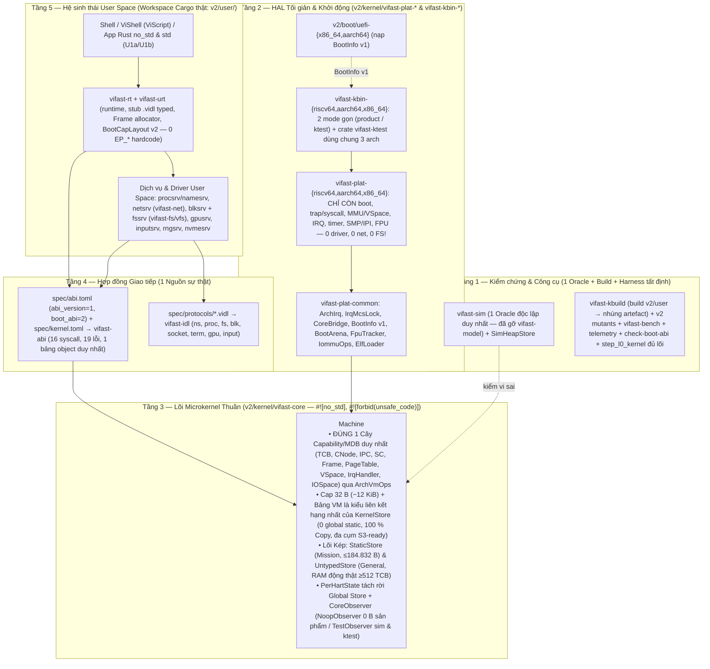

# KẾ HOẠCH ĐẠI TU & PHÁT TRIỂN KIẾN TRÚC VIFASTOS (`KT-400..KT-424`, 47 task ≤ 3 h — cập nhật `D2-263`)

**Người ban hành**: **Agent 0** (theo chỉ đạo trực tiếp của người điều phối, **D2-259** `2026-11-24`, hiệu đính **D2-260** `2026-11-25`, **D2-261**, **D2-262** & **D2-263** `2026-11-26`).
**Trạng thái**: **HIỆU LỰC NGAY — KẾ HOẠCH DUY NHẤT ĐANG CHẠY** (**32/47 `DONE`** — Chặng 0 & Chặng 1 xong 100 %, W7a khép sạch T2 PASS 81/81 @ `0f26bebc`; **4 `READY`** Đợt `W7b` đủ 4/4 slot; **11 `BLOCKED`** thuần theo DAG; **0 chờ duyệt**). Toàn bộ các kế hoạch phát hành trước đây (`v2.0`, `v2.1`, `KT-348`, Chu kỳ 2/3 cũ) đã được **huỷ bỏ hoàn toàn** và lưu trữ tại `v2/agent/archive/reports/`.
**Nguồn sự thật**: [`AGENTS.md`](AGENTS.md), [`v2/AGENTS.md`](v2/AGENTS.md), [`docs/QUYET-DINH-sau-review.md`](docs/QUYET-DINH-sau-review.md), [`v2/agent/DECISIONS.md`](v2/agent/DECISIONS.md) (**D2-259**..**D2-263**), [`v2/agent/QUEUE.md`](v2/agent/QUEUE.md).
**Nhãn số liệu (QD §2.2 & §9 Q12)**: mọi hằng số thiết kế/ngân sách trong kế hoạch này mang nhãn `[TK]` (mặc định), giả thuyết `[GT]`, ước lượng `[ƯL]`; tuyệt đối không chứa số đo hiệu năng viết tay (mọi số đo chỉ dẫn từ nhật ký máy đo trong `v2/agent/JOURNAL/`).

> **Tuyên ngôn chỉ đạo (`D2-259`, cập nhật `D2-263`)**: **Bỏ toàn bộ áp lực phát hành (`v2.0` / `v2.1` / tag / báo cáo phát hành / `nightly --soak` 1.000×3 trên nền cũ).** Tập trung **100 % vào tái cấu trúc và hoàn thiện kiến trúc Microkernel sạch, minh bạch, dễ bảo trì và dễ mở rộng** — giữ vững kỷ luật kiểm chứng kỹ thuật (`T0`/`T1`/`T2`, đóng điểm mù 153 ca host lõi ở `step_l0_kernel`, khóa SSOT `tap-parity.sh` cho soak, test đỏ-trước, đột biến có răng, `forbid(unsafe_code)`, tối ưu cấu trúc thay vì dùng global `static` hay nới pin, giữ cứng ratchet `B1.1`, không retry `D2-07`, không GitHub Actions `D2-241`, lịch giờ DeepSeek `D2-256`).

---

## 1. Kiến trúc Đích 5 tầng (Rõ ràng — 1 Nguồn sự thật — 0 Nhân bản)

Mọi task trong kế hoạch này đều phục vụ trực tiếp việc đưa cây mã về đúng **Kiến trúc Đích 5 tầng** dưới đây — chấm dứt dứt điểm **11 nút thắt** đã đo được trên mã nguồn:



### Bảng 11 nút thắt gốc & tiến độ giải quyết (cập nhật `D2-262`)

| # | Nút thắt gốc (đo trực tiếp từ mã nguồn) | Giải pháp đích trong kế hoạch | Trạng thái & Task |
|---|---|---|---|
| **1** | **2 Object/Capability Layer tách đôi trong kernel**: `vifast-core` (`[limits.core]`) vs `vifast-plat-common::obj` (`[limits.plat]`, 2.424 LOC / 33 caller) | Đóng gói `Cap` `56→32 B` (−12 KiB), dời `obj` → `vifast-core/src/vm/`, đưa bảng VM làm kiểu liên kết hạng nhất của `KernelStore` + `ArchVmOps`, xoá bảng thứ hai/`core_foreign.rs`/`[limits.plat]` | **`KT-417` DONE → `KT-417b` (READY) → `KT-417d`** |
| **2** | **Driver & dịch vụ phình trong kernel (`B1`)**: `3.567` LOC ở `kbin-riscv64` + 3 `plat-*` → `vifast-net` + 23 tệp driver | Giữ cứng ratchet `B1.1` (`≤ 23`, cấm tăng), sau đó tách sạch **`netsrv` → `blksrv`/`fssrv` → `gpusrv`/`inputsrv`/`rngsrv`** (`driver_files → 0`) + chứng minh mở rộng bằng **`nvmesrv`** (0 dòng kernel) | **`KT-403` DONE → `KT-419/419b` → `KT-421..423b`** |
| **3** | **`v2/user/` chưa là workspace Cargo thật (`B4`) + nợ `N-7` P20 + `build.rs` lặp** | Cargo workspace thật (`clippy` + test trong `v2 check`), crate `vifast-kbuild`, 3 lockfile đồng bộ, máy kiểm `check-boot-abi.py`, đóng `N-7` P20 | **DONE (`KT-404`, `KT-404c`, `KT-404d`)** |
| **4** | **Trộn dữ liệu Oracle/Test vào `Machine`/`TcbData`** (`TcbData = 824 B > 512 B` ABI) | Tách `CoreObserver` (`NoopObserver` 0 B) + thân ABI in-place (`TcbCore ≤ 496 B`, `EndpointCore ≤ 48 B`) | **DONE (`KT-405`, `KT-408`)** |
| **5** | **Bảng tĩnh cố định khóa cứng `64 TCB / 256 Obj / 192 CNode slot`** | **Lõi Kép `Machine<S: KernelStore>`**: `StaticStore` (`Mission`, `Copy`, `≤ 184.832 B`) + `UntypedStore` (`General`, `BootArena`, `≥ 512 TCB / ≥ 1.024 Cap`, thêm bảng VM đa hình ở `KT-417d`) | **DONE (`KT-405`, `KT-408`, `KT-410`)** |
| **6** | **Big Kernel Lock (`IrqMcsLock<Machine>`) toàn cục cản SMP & IRQ** | Tách `PerHartState` + đo tranh khoá BKL 4 hart (`KT-415`: ngưỡng S3 kích hoạt ở 93,5 % tải bão hoà) + `Tier2Mailbox` | **Tiền đề DONE (`KT-405`, `KT-412..415`); khoá Per-Hart + `HartSched` General = #1 hậu `KT-424`** |
| **7** | **17 hằng số `EP_*` (+ 8 `SLOT_*`/`LOOP_*` + 2 mảng) hardcode rải rác giữa kernel & userland** | `BootCapLayout` `boot_abi = 1` sinh từ `spec/abi.toml` (`KT-417`), 6 `.vidl` + `namesrv` (`KT-420`), nâng `boot_abi = 2` (`SELF_TCB`, `SELF_CSPACE`, `NS_EP`) bỏ 17 `EP_*` (`KT-420b`) | **`KT-404d`/`KT-417` DONE → `KT-420` → `KT-420b`** |
| **8** | **3 mô hình kernel song song (`B2`)**: `vifast-core`, `vifast-sim`, `vifast-model` | Đúng **2 thực thể**: `vifast-sim` (oracle độc lập) + `vifast-core` (sản phẩm) + `SimHeapStore`; **đã gỡ `vifast-model`** | **DONE (`KT-410`)** |
| **9** | **Test trong kernel phân mảnh (`B5`) & `kbin-riscv64` 14 `[[bin]]` (`32,7k` LOC)** | Crate `vifast-ktest` generic đa arch + gom `kbin-riscv64` 14 `[[bin]]` → 2 + hợp nhất `smp_suite` 3 arch + gỡ trọn 2.162 LOC `sched.rs` x64 | **DONE (`KT-411`, `KT-411b`, `KT-413b`, `KT-413c`)** |
| **10** | **HAL lặp + dev-dep ngược + Sv39/PLIC lẫn trong `plat-common` + cổng `clippy`/test bỏ sót `v2/kernel/`** | Đưa `TableMemory`/Sv39 lên `vifast-pte`, dời RISC-V logic sang `vifast-plat-riscv64-logic`, gỡ dev-dep ngược, rút `IrqMcsLock`/`CoreBridge`, nối `clippy` kernel (`KT-409`) & nối `vifast-core`/`vifast-ktest` vào `step_l0_kernel` (`D2-262`) | **DONE (`KT-409`, `KT-409b`, `KT-411`; Lead nối `step_l0_kernel` ở `D2-262`)** |
| **11** | **Kho nặng rác v1 (~62 %), 3 `Cargo.lock` (`B3`), tooling ~53k LOC, 7 `E_WRONG-REASON` mutants, flake `persist --crash`, lệch SSOT `soak-{a64,x64}`** | Gỡ v1, `check-lockfile-sync.py` 3 lockfile, `v2 mutants` git-tree thật (`7/7 KILLED`), `Machine::now` `riscv64`, cắt điện tất định `persist.sh --crash`, khóa SSOT `lib/tap-parity.sh` + probe fail-fast `soak-aarch64.sh` | **`KT-400/403/407/404c/408b/408c` DONE → `KT-408d`, `KT-408e` (READY)** |

---

## 2. Nguyên tắc vận hành cho chương trình Đại tu (không có gánh nặng phát hành)

1. **Tập trung kiến trúc sạch, KHÔNG chạy soak phát hành lãng phí**: bỏ hoàn toàn `KT-348`, báo cáo `R2-v2`, tag `v2.0`/`v2.1` và `nightly --soak` 1.000×3 trên nền kiến trúc cũ đang bị thay thế (`D2-259`/`D2-263`).
2. **Giữ vững kỷ luật an toàn & tối ưu cấu trúc khi refactor mạnh**:
   - Mọi task `≤ 3 h`, mã task hợp lệ `^KT-[0-9]+[a-z]?$` (`KT-400..KT-424`), **0 % chồng chéo tệp** giữa các slot song song và **tối đa 1 cửa sổ sửa `spec/abi.toml` mỗi đợt**.
   - **Không dùng global `static` cho trạng thái chính thức của lõi** (`D2-262`): mọi bảng chính thức (`Cap`, `Meta`, VM mappings/flushes/`FrameArena`) thuộc `KernelStore` bên trong `Machine<S, O>` để giữ 100 % `Copy`, `forbid(unsafe_code)`, kiểm vi sai độc lập, mở rộng `UntypedStore` và đa cụm `S3`.
   - **Định nghĩa trần LOC `vifast-core` (`Q3`, `D2-262`)**: giữ nguyên mục tiêu **≤ 25.000 dòng mã sản phẩm `[ƯL]`** (loại trừ `*_tests.rs`/`test_lock.rs`/`tests/`/`#[cfg(test)]`, đúng `ViFastOs-v2-thiet-ke.md:700`), giữ cứng R1 `≤ 1.500` dòng/tệp.
   - Sub-agent chỉ chạy **T0 (`v2 t0`) + T1 (`v2 gate --dev`)** ở Giờ Thấp điểm DeepSeek (`0,5×`); Lead gom lô chạy **T2 (`v2 gate --fast`) + `L1-medium` + Miri + `v2 mutants --all` + `vifast-bench`** ở Giờ Cao điểm (`2×`, 0 token LLM, `D2-256`).
   - Không nới ngưỡng, không nới `b1.1-ratchet.toml` (`driver_files ≤ 23`, chỉ giảm), không retry `D2-07`, không GitHub Actions `D2-241`.
   - **Cửa sổ sửa `spec/` được Agent 0 cấp phép tường minh (`D2-261`/`D2-262`, giữ `abi_version = 1`, `min_compat = 1`)**: `KT-417` (DONE), `KT-417b` (chỉ đổi tạm `source` `[limits.plat]` trong `spec/kernel.toml`), `KT-417d` (xoá `[limits.plat]` trong `spec/kernel.toml`, gỡ `unsupported` `PageTable.{Map,Unmap}` + F6 `errors=[...]` trong `spec/abi.toml`), `KT-417c` (`sysret_ready = true` trong `spec/kernel.toml`), `KT-419` (`Irq*` + `Frame.{MapIo,UnmapIo}` trong `spec/abi.toml`), `KT-419b` (`IOSpace` trong `spec/abi.toml`), `KT-420` (chỉ `spec/protocols/*.vidl`), `KT-420b` (`boot_abi = 2` + gỡ `unsupported` `Tcb.Exec` trong `spec/abi.toml`). Mọi task khác cấm sửa `spec/`.

---

## 3. Đồ thị Sóng thi công 0 % chồng chéo tệp (`KT-400..KT-424` — 47 task, 4 Chặng, cập nhật `D2-263`)

```text
[CHƯƠNG TRÌNH ĐẠI TU KIẾN TRÚC VIFASTOS (D2-259 / D2-260 / D2-261 / D2-262 / D2-263)]
  │
  ═══════════════════════════════════════════════════════════════════════════════
  CHẶNG 0 — DỌN MẶT BẰNG, RATCHET & USER WORKSPACE         [DONE 100 % — 9/9 task]
  ═══════════════════════════════════════════════════════════════════════════════
  ✓ W1–W2: KT-400, KT-401, KT-401b, KT-402, KT-403, KT-404, KT-405, KT-406, KT-407
  │
  ═══════════════════════════════════════════════════════════════════════════════
  CHẶNG 1 — LÕI KÉP, HAL SẠCH, KTEST CHUNG & UEFI          [DONE 100 % — 12/12 task]
  ═══════════════════════════════════════════════════════════════════════════════
  ✓ W3–W4: KT-402b, KT-404c, KT-404d, KT-408, KT-408b, KT-409, KT-409b,
           KT-410, KT-411, KT-411b, KT-414, KT-414b
  │
  ═══════════════════════════════════════════════════════════════════════════════
  CHẶNG 2 — SMP 4 HART 3 ARCH, 1 CÂY CAP DUY NHẤT & ABI SẠCH [11 DONE / 4 READY / 2 BLOCKED]
  ═══════════════════════════════════════════════════════════════════════════════
  ✓ W5–W6: KT-412, KT-413, KT-413b, KT-415, KT-416 (APPROVED), KT-416b (APPROVED),
           KT-418, KT-418b
  ✓ W7a  : KT-417 (spec ABI + [boot_caps] + 4 method + F1/F2/F3/F5),
           KT-413c (xoá 2.162 LOC sched.rs x64),
           KT-408c (mutants 7/7 KILLED + Machine::now rv + 5 SLOT_EP + --bkl)
           [T2 PASS 81/81 @ 0f26bebc; Peak 2 @ becc1756: L1-medium 40k → mutants --all → Miri]
           [Đầu 10:00 UTC — Lead D2-253: pull + nối -p vifast-core -p vifast-ktest vào step_l0_kernel + T1]
  │
  ▼ ĐỢT W7b [READY NGAY — Thấp điểm 0,5× | ĐỦ 4/4 Slot song song | 0 % chồng tệp]
  ├── [Slot 1 — P0 ĐƯỜNG GĂNG]  KT-417b [READY] (Đóng gói Cap 56→32 B −12 KiB + dời plat-common::obj → vifast-core/src/vm/ + đóng Q6)
  ├── [Slot 2 — P1 Hardening]   KT-418c [READY] (Vá -cpu max VSpace TF=1 + hardening-max.sh SMEP/SMAP/PAN + cfg(target_os="none") a64 fpu.rs)
  ├── [Slot 3 — P1 Tất định]    KT-408d [READY] (Cắt điện tất định MODE_CRASH_MID_WRITE cho persist.sh --crash, đóng Q7)
  └── [Slot 4 — P1 SSOT Soak]   KT-408e [READY] (lib/tap-parity.sh khóa soak==run==kbin trong T2 + đồng bộ/siết TAP 47..50 + probe fail-fast a64)
        └──► [Cao điểm: Lead merge + T2 (gồm 153 test lõi + tap-parity) + xác nhận nhanh soak-x86_64 (KT-413c)]
  │
  ▼ ĐỢT W8a [Thấp điểm 0,5× | 2 Slot song song | 0 % chồng tệp | khác hoàn toàn cây thư mục & Cargo.lock!]
  ├── [Slot 1 — P0 ĐƯỜNG GĂNG]  KT-417d (Bảng VM vào KernelStore + ArchVmOps + PageTable.{Map,Unmap} + XOÁ [limits.plat] & core_foreign.rs + đóng Q4 F6)
  └── [Slot 2 — P0 User IDL]    KT-420  (6 .vidl + vifast-idl + namesrv + PageSource vifast-rt — 0 chạm v2/kernel/ & spec/{abi,kernel}.toml!)
        └──► [Cao điểm: Lead merge + T2 + L1-medium 40k + Miri]
  │
  ═══════════════════════════════════════════════════════════════════════════════
  CHẶNG 3 — MICROKERNEL ĐÚNG NGHĨA: ĐẨY SẠCH DRIVER & DỊCH VỤ RA USER SPACE (B1.2)
  ═══════════════════════════════════════════════════════════════════════════════
  ▼ ĐỢT W8b [Thấp điểm 0,5× | 2 Slot song song | 0 % chồng tệp | Slot 1→abi.toml, Slot 2→kernel.toml]
  ├── [Slot 1 — P0 ĐƯỜNG GĂNG]  KT-419  (Driver Infra P1: IrqControl/IrqHandler → Notification + Frame.MapIo/UnmapIo 3 arch + ca âm #1 + Q5 TAP Notification chết)
  └── [Slot 2 — P1 x64 Fast]    KT-417c (x86_64 syscall/sysret + GDT planned giữ int 0x80 & 7C-r13 + sysret_ready=true + phục hồi preempt CPL3)
        └──► [Cao điểm: Lead merge + T2]
  │
  ▼ ĐỢT W8c [Thấp điểm 0,5× | 1 Slot đường găng — sở hữu spec/abi.toml]
  └── [Slot 1 — P0 ĐƯỜNG GĂNG]  KT-419b (Driver Infra P2: IOSpace IOMMU cô lập DMA 3 arch qua virtio-iommu-pci dùng chung + trait IommuOps + ca âm #2)
        └──► [Cao điểm: Lead merge + T2]
  │
  ▼ ĐỢT W8d [Thấp điểm 0,5× | 1 Slot đường găng — sở hữu spec/abi.toml]
  └── [Slot 1 — P0 User Space]  KT-420b (BootCapLayout v2 boot_abi=2 bỏ 17 EP_* + Tcb.Exec(elf_frame) 3 arch + vifast-rt Frame thật + # build: a64/x64)
        └──► [Cao điểm: Lead merge + T2]
  │
  ▼ ĐỢT W9 [Thấp điểm 0,5× | 3 Slot song song | 0 % chồng tệp (Lead dọn Cargo.toml & ratchet lúc merge)]
  ├── [Slot 1 — B1.2 Mạng]      KT-421  (Tách netsrv + virtio-net 100 % ra v2/user/ + socket.vidl → GỠ vifast-net/net_svc/proc_net/tcp khỏi kernel; dep_edges 3→0!)
  ├── [Slot 2 — B1.2 Đĩa/FS]    KT-422  (Tách blksrv + fssrv 100 % ra v2/user/ qua blk.vidl/fs.vidl + IOSpace → GỠ proc_fs/virtio_blk/vifast-fs/vfs khỏi kernel!)
  └── [Slot 3 — B1.2 GPU/RNG]   KT-423  (Tách gpusrv + inputsrv + rngsrv ra User Space → GỠ sạch virtio_*/vifast-virtio; driver_files → 0 vĩnh viễn!)
        └──► [Cao điểm: Lead merge + T2 + v2 mutants --all]
  │
  ▼ ĐỢT W9b [Thấp điểm 0,5× | 1 Slot — Bằng chứng mở rộng thuần User Space]
  └── [Slot 1 — Mở rộng 0 lõi]  KT-423b (PCIe MSI-X + NVMe U-mode nvmesrv trên -device nvme: 100 % v2/user/, 0 dòng thêm vào v2/kernel/, driver_files giữ 0!)
        └──► [Cao điểm: Lead merge + T2]
  │
  ▼ ĐỢT W10 [Thấp điểm + Cao điểm kiểm định kiến trúc — KHÔNG soak phát hành]
  └── [Chốt Kiến trúc Sạch]     KT-424  (Port ViShell/ViScript + PoC Rust std PAL U1b + Kiểm toán kiến trúc: T2 + L1-medium 40k 2 Store + Miri + v2 mutants + vifast-bench --bkl)
```

---

## 4. Bảng đặc tả chi tiết 47 task (`KT-400..KT-424`, mọi task ≤ 3 h)

### Chặng 0 & Chặng 1 — ĐÃ HOÀN TẤT 100 % (21/21 task `DONE`, T2 PASS 81/81)

- **Chặng 0 (`9/9 DONE`)**: `KT-400` (dọn kho/v1), `KT-401` (xả R1 + ELF 32 KiB + `NBSend` một luật + `.corespace` NOLOAD rv), `KT-401b` (W^X 4 KiB rv + `.corespace` NX 3 arch), `KT-402` (`BootInfo` v1 + DTB/ACPI), `KT-403` (ratchet `B1.1` + `v2 mutants` + telemetry + `vifast-trace` + `vifast-bench`), `KT-404` (`v2/user/` Cargo workspace + `vifast-kbuild` + `N-7` + 9 crate `forbid(unsafe_code)`), `KT-405` (`CoreObserver` + `PerHartState` + intrusive ready queue + `TcbCore`/`EndpointCore` + dọn clippy `vifast-core`), `KT-406` (UART RX IRQ 3 arch + `LD_PRELOAD`), `KT-407` (tooling + `run-common.sh` + vá `guard_selftest` case 9 + `B3` lockfile).
- **Chặng 1 (`12/12 DONE`)**: `KT-402b` (harness `a64 -dtb` + `x64 fw_cfg` + ca âm), `KT-404c` (3 lockfile + gom `build.rs` 698→534), `KT-404d` (`check-boot-abi.py` bước cổng 85), `KT-408` (`KernelStore` + `Machine<S,O>` + ring trace `.corespace`), `KT-408b` (`pmemsave` đầu-cuối + vá `#[used]` `RING` + 3 đột biến `mut-ring-*`), `KT-409`/`KT-409b` (đại tu HAL + `TableMemory`/Sv39 → `vifast-pte` + `vifast-plat-riscv64-logic` + nối `clippy` kernel vào `v2 check`), `KT-410` (`UntypedStore` + `BootArena` + `SimHeapStore` + gỡ `vifast-model` `B2`), `KT-411`/`KT-411b` (`vifast-ktest` generic + `IrqMcsLock<T,S>` chung + gom 14 `[[bin]]` → 2), `KT-414`/`KT-414b` (UEFI `x86_64` OVMF & `aarch64` AAVMF + `BootSource::Uefi`).

### Chặng 2 — SMP 4 Hart 3 Arch, Hợp nhất 1 Cây Capability Duy nhất & ABI Sạch (`11 DONE` + `6 task` còn lại)

- **Đã `DONE` trong Chặng 2 (`11 task`)**: `KT-412` (SMP 4 hart rv/a64), `KT-413`/`KT-413b`/`KT-413c` (SMP 4 hart x64 + đóng `N-3` + `smp_suite` 3 arch + `pcid.rs` mặc định tắt + xoá trọn 2.162 LOC `sched.rs`), `KT-415` (`Tier2Mailbox` + `OVERFLOW` + range shootdown 3 arch + đo BKL 4 hart), `KT-416`/`KT-416b` (RFC 8 nhóm — **APPROVED `D2-261`**), `KT-417` (cửa sổ `spec/` ABI sạch + `[boot_caps]` 66 B + 4 invocation + vá F1/F2/F3/F5), `KT-408c` (`mutants` git-tree thật 7/7 KILLED + `Machine::now` `riscv64` + 5 `SLOT_EP_*` + `vifast-bench --bkl`), `KT-418`/`KT-418b` (FPU/SIMD eager + `SUM`/`SMEP`/`SMAP`/`PAN` + `vifast-virtio::{rng,rngdev}` + `EntropyPool` + fuzz `vifast-net`).

| Mã | Ưu tiên | Task | Phụ thuộc | Ngân sách | Tiêu chí xong (DoD) & Ranh giới tệp (`D2-262`/`D2-263`) |
|---|---|---|---|---|---|
| **KT-417b** | P0 | **Hợp nhất 1 Cây Cap/MDB bước 1: Đóng gói `Cap` (`56→32 B`, −12 KiB) + Dời `plat-common::obj` → `vifast-core/src/vm/` + Đóng `Q6`** | `KT-417` | 2,5 h | **`READY` NGAY (W7b Slot 1, `D2-262`)**: (1) đóng gói `Cap` trong `vifast-core/src/objmeta.rs` (`56→32 B`, thu hồi `12.288 B` trên `StaticStore` / `24 KiB` trên `UntypedStore`, pin `size_of::<Cap>() == 32` + ca biên `slot=4095`/`badge` trong `footprint.rs`, hạ ghim cỡ chính xác khuôn `KT-405` — **KHÔNG nới `184.832 B` hay `196.608 B`**); (2) dời `plat-common/src/obj/{mod,vspace,check,arena}.rs` (2.424 LOC) → `vifast-core/src/vm/` (thêm dep thuần `vifast-pte` + `vifast-alloc`, giữ `forbid(unsafe_code)`, giữ shim re-export mỏng ở `plat-common::obj`, cập nhật tạm `source` `[limits.plat]` trong `spec/kernel.toml`); (3) đóng Q6: assert 4 delta (`mutated`/`rotated`/`bound`/`unbound`) trong `ktest_inv.rs::ok18` + thêm 2 đột biến `core-host` trong `mutants.toml`; T2 PASS. |
| **KT-418c** | P1 | **Điều tra & vá lỗi thật `-cpu max` `VSpace` isolation (`TF=1`) + `hardening-max.sh` (`SMEP`/`SMAP`/`PAN`) + di động host `a64 fpu.rs`** | `KT-413c, KT-418b` | 2 h | **`READY` NGAY (W7b Slot 2, `D2-261`/`D2-262` — KHÔNG nới `b1.1-ratchet.toml`)**: (1) điều tra & vá lỗi có sẵn lộ ở `KT-418b` §6.4 (`ktest x86_64 -cpu max` dừng ở `# exc: vec=14 err=0x6 rflags=0x10202 [TF=1]`), kèm test đỏ-trước; (2) tạo kịch bản độc lập `v2/test/boot/hardening-max.sh` kiểm ca âm phần cứng `SMEP`/`SMAP` (`x64 -cpu max`) & `PAN` (`a64 -cpu max`), **0 chạm `run-{x86_64,aarch64}.sh`**; (3) bọc `#[cfg(target_os = "none")]` cho inline asm trong `vifast-plat-aarch64/src/asm/fpu.rs`; 0 sửa `spec/`; T2 PASS. |
| **KT-408d** | P1 | **Cắt điện tất định cho `persist.sh --crash` (`MODE_CRASH_MID_WRITE`, đóng `Q7`)** | `KT-408c` | 1,5 h | **`READY` NGAY (W7b Slot 3, `D2-262`)**: mở rộng kịch bản 32 B `PL75` tại LBA 0 (byte dự phòng `17..20`, tương thích ngược `mode=0..2`) thêm `MODE_CRASH_MID_WRITE = 3` + `crash_after_writes: u32`; khi pha 7 đẩy đủ `N` sector xuống thiết bị (vd 72/144 block, còn block bẩn trong `CACHE_DATA`), `ktest_persist` in `# persist: crash_cut` và `PLATFORM.halt(77)` **KHÔNG flush**; `persist.sh --crash` bỏ poll `sleep 0.05`, luôn kiểm `partial=1` + `fsck` + `dọn tệp dở` + phục hồi đủ `b07r → b08r → b01r`, kèm ca đỏ-trước (`records=13`); 0 sửa `spec/`; T2 PASS. |
| **KT-408e** | P1 | **Chống lệch SSOT vĩnh viễn cho `soak-{aarch64,x86_64}.sh` (`46`/`47`→`50`, `lib/tap-parity.sh`, probe fail-fast `a64`)** | `KT-412, KT-413c, KT-418` | 1,5 h | **`READY` NGAY (W7b Slot 4, `D2-263` — CHỈ chạm `soak-{aarch64,x86_64}.sh` + `lib/tap-parity.sh`, 0 chạm `run-*.sh`)**: (1) đồng bộ & siết bất biến ngang `run-*.sh`: `soak-aarch64.sh` (`46→50`, `# smp core:`, `# pan:`, `ok 50 - pan: el1 khong doc trang el0`, ≥ 2 ca âm), `soak-x86_64.sh` (`47→50`, `ok 48/49`, `# smep/smap: … hardened=1`, `ok 50 - smep/smap: bat va ca am`, ≥ 2 ca âm); (2) dựng `v2/test/boot/lib/tap-parity.sh` gọi trong `--selftest` (chạy mọi T2, 0 bước cổng mới) khẳng định `soak.TAP_TESTS == run.EXPECT_TESTS == kbin.TAP_TESTS` + ca âm lệch ±1 ⇒ ĐỎ; (3) probe fail-fast cho `soak-aarch64.sh` (`monitor-sendkey.py` + `check_boot_log` ⇒ `exit 3` sau ~2 s thay vì đốt 971 s) + bằng chứng đỏ-trước (`--smoke 1 1`); 0 sửa `spec/`; T2 PASS. |
| **KT-417d** | P0 | **Hợp nhất 1 Cây Cap/MDB bước 2: Bảng VM vào `KernelStore` + `ArchVmOps` + `PageTable.{Map,Unmap}` + Xoá `[limits.plat]`/`core_foreign.rs` + Đóng `Q4` F6** | `KT-417b` | 3 h | **(W8a Slot 1 — ĐƯỜNG GĂNG mở khoá Chặng 3, chủ sở hữu duy nhất `spec/{abi,kernel}.toml` ở W8a)**: (1) đưa bảng VM (`VmMappings`/`VmFlushes`/`VmUntypeds`/`VmObjMeta`) vào làm **kiểu liên kết hạng nhất của `KernelStore`** (đa hình cho cả `StaticStore` `64/16/4` lẫn `UntypedStore` `256/32/16`, **CẤM global `static`**, giữ `Copy` + `forbid(unsafe_code)` + `size_of::<Machine>()` ≤ `184.832 B`); (2) hợp nhất `Frame`/`PageTable`/`VSpace` vào 1 cây Cap/MDB qua `ArchVmOps`, **xoá sạch bảng thứ hai + shim `plat-common::obj` + `core_foreign.rs`**; (3) cài `PageTable.{Map,Unmap}` (gỡ `unsupported` trong `spec/abi.toml`), **xoá `[limits.plat]` khỏi `spec/kernel.toml` + sửa `check_kernel.py:277`**; (4) đóng Q4 F6: thêm `errors = [...]` cho 13 `[method_signature]` mới + kiểm máy `check_abi.py`; (5) chứng minh `CNode.Revoke` 1 `Untyped` thu hồi đồng thời `TCB`+`VSpace`+`Frame`+`PageTable`; T2 PASS. |
| **KT-417c** | P1 | **Bật `x86_64` `syscall`/`sysret` (`swapgs` + GDT `planned`, giữ `int 0x80` & `7C-r13`) + Phục hồi phủ preempt CPL3** | `KT-417, KT-418c` | 3 h | **(W8b Slot 2 — song song `KT-419`, chỉ chạm `spec/kernel.toml`)**: (1) áp GDT `planned` (`user_data=0x18`, `user_code=0x20`, `STAR[63:48]=0x10`) + đường `syscall`/`sysret` (`swapgs`, giữ `7C-r13`); (2) **giữ song song cổng `int 0x80`** (`min_compat = 1`, `mut-no-int80` còn ĐỎ) + TAP/ca âm `syscall`/`sysret`; (3) **đóng nợ `KT-413c` §6.1**: phục hồi bằng chứng & TAP preempt khi đang ở CPL3 (`# sched: cpl3 preempted=1 resumed=1 cs=0x23`); (4) lật `sysret_ready = true` trong `spec/kernel.toml:126` + `check_kernel.py:398-399` + cập nhật selector trong `run-x86_64.sh`/`soak-x86_64.sh`; 0 chạm `asm/fpu.rs`; T2 PASS. |

### Chặng 3 — Microkernel Đúng nghĩa: Đẩy sạch Driver & Dịch vụ ra User Space (`B1.2`, Đợt W8a → W10, `9 task`)

| Mã | Ưu tiên | Task | Phụ thuộc | Ngân sách | Tiêu chí xong (DoD) & Ranh giới tệp (`D2-262`) |
|---|---|---|---|---|---|
| **KT-420** | P0 | **User Space phần 1: 6 `.vidl` + `vifast-idl` + `namesrv` + trait `PageSource` `vifast-rt`** | `KT-417b, KT-418b` | 3 h | **(W8a Slot 2 — song song `KT-417d`, 0 chạm `v2/kernel/` lẫn `spec/{abi,kernel}.toml`)**: (1) hoàn thiện đủ 6 `.vidl` chuẩn trong `spec/protocols/` (`ns`, `proc`, `fs`, `blk`, `socket`, `term`) + sinh stub Rust typed `vifast-idl`; (2) dựng dịch vụ `namesrv` trong `v2/user/` (đăng ký/tra cứu endpoint theo tên + host test); (3) tách trait `PageSource` cho allocator `vifast-rt` (sẵn sàng cắm `Frame` thật ở `KT-420b`); T2 PASS. |
| **KT-419** | P0 | **Nền tảng Driver U-mode P1: `IrqControl`/`IrqHandler` → `Notification` + `Frame.MapIo`/`UnmapIo` 3 arch + TAP Notification chết (`Q5`)** | `KT-417d` | 3 h | **(W8b Slot 1 — sở hữu duy nhất `spec/abi.toml` ở W8b)**: nâng `IrqControl` (12)/`IrqHandler` (13) → `core` & gỡ `unsupported` cho `Irq*`/`Frame.{MapIo,UnmapIo}` trong `spec/abi.toml` (+ `check_reserved.py`/`check_abi.py`/`vifast-abi`); cài trên 3 arch; **ca âm #1 bắt buộc**: bỏ `IrqHandler.Ack` ⇒ ngắt không tái phát (ĐỎ); **đóng Q5**: thêm 1 TAP ảnh thật chứng minh `CNode.Revoke` trên `Untyped` chủ gỡ `bound_notification` của TCB và tái bind an toàn sau tái dùng `ObjId`; T2 PASS. |
| **KT-419b** | P0 | **Nền tảng Driver U-mode P2: `IOSpace` IOMMU Cô lập DMA 3 arch qua `virtio-iommu-pci` dùng chung** | `KT-419` | 3 h | **(W8c Slot 1 — sở hữu `spec/abi.toml`)**: nâng `IOSpace` (14) → `core` & gỡ `unsupported` cho `IOSpace.{Flush,Attach}` trong `spec/abi.toml`; cài trait `IommuOps` + driver chuẩn **`virtio-iommu-pci`** dùng chung 3 arch trên QEMU PCIe (`VIRTIO_F_ACCESS_PLATFORM`, VT-d/SMMUv3 vật lý chuyển `HW1`); **ca âm #2 bắt buộc**: thiết bị DMA ghi ngoài bảng trang `IOSpace` ⇒ bị chặn ngay với lỗi có tên; T2 PASS. |
| **KT-420b** | P0 | **User Space phần 2: `BootCapLayout` v2 (bỏ 17 `EP_*`) + `Tcb.Exec(elf_frame)` 3 arch + `vifast-rt` `Frame` thật + `# build:` `a64`/`x64`** | `KT-417d, KT-420` | 3 h | **(W8d Slot 1 — sở hữu `spec/abi.toml`)**: (1) nâng `[boot_caps]` lên **`boot_abi = 2`** tối giản (`SELF_TCB`, `SELF_CSPACE`, `NS_EP`), gỡ sạch 17 `EP_*` hardcode sang cấp cap động qua `namesrv`/`procsrv`, cập nhật `vifast-gen`, `boot_caps_layout.rs`, `check_abi.py`, `check-boot-abi.py`; (2) cài thật **`Tcb.Exec(tcb, elf_frame, vspace, entry_arg?)`** (method 16 nhận cap `Frame`, gỡ `unsupported`) trên 3 arch; (3) nối `PageSource` của `vifast-rt` vào cấp trang `Frame`/`Untyped` thật (`free` DRAM+Store) và chuyển `exec(path)` đọc ELF vào `Frame` ở User Space; (4) in `BUILD_LINE` (`# build:`) trên ảnh ktest `aarch64`/`x86_64` (`KT-404c` nợ #2); T2 PASS. |
| **KT-421** | P0 | **`B1.2` bước 1 — Tách `netsrv` + `virtio-net` 100 % ra User Space (`v2/user/`) & Gỡ `vifast-net` khỏi kernel** | `KT-419b, KT-420b, KT-406` | 3 h | Chạy driver `virtio-net` (`Frame.MapIo` + `IrqHandler` + `IOSpace`) và toàn bộ ngăn xếp mạng `vifast-net` (DHCP/ARP/ICMP/UDP/DNS/TCP đầy đủ `socket.vidl`, `ping`/`ifconfig`) **100 % ở User Space**; **xóa sạch `net_svc.rs`, `proc_net.rs`, `virtio_net.rs`, `tcp.rs` (kèm nhánh chết `product-net` ở `riscv64/build.rs:206`) và gỡ dep `vifast-net` khỏi cả 3 `vifast-plat-*` và `vifast-kbin-*`**; siết ratchet `b1.1-ratchet.toml` (`dep_edges` 3→0, cấm tuyệt đối `vifast-net` trong kernel); T2 PASS. |
| **KT-422** | P0 | **`B1.2` bước 2 — Tách `blksrv` + `fssrv` (`virtio-blk` + `vifast-fs`/`vfs`) 100 % ra User Space & Gỡ khỏi kernel** | `KT-419b, KT-420b` | 3 h | Chạy driver `virtio-blk` (`blksrv`, qua `Frame.MapIo` + `IrqHandler` + `IOSpace`) và hệ thống tệp `vifast-fs`/`vifast-vfs` (`fssrv`, qua `blk.vidl`/`fs.vidl`) **100 % ở User Space** (giữ đủ lệnh FS `ls`/`cat`/`write`/`mkdir`/`rm`/`mv`/`ln`/`fsck`/`df` & bền đĩa persist); **xóa sạch `proc_fs.rs`, `virtio_blk.rs` và gỡ `vifast-fs`/`vifast-vfs` khỏi kernel**; siết ratchet **cấm tuyệt đối FS/VFS trong kernel**; T2 PASS. |
| **KT-423** | P1 | **`B1.2` bước 3 — Tách `gpusrv` + `inputsrv` + `rngsrv` (`virtio-rng`) ra User Space (Đích cuối `plat-*` 0 driver!)** | `KT-419b, KT-420b` | 3 h | Chạy `virtio-gpu` (`gpusrv`, giữ PPM 23/23), `virtio-input` (`inputsrv`) và **`virtio-rng` (`rngsrv`, từ `vifast-virtio::{rng,rngdev}` của `KT-418b`)** 100 % ở User Space (`gpu.vidl`/`input.vidl`); **gỡ sạch `virtio_*` & `vifast-virtio` khỏi `vifast-plat-*`** — đạt đích cuối: **`vifast-plat-*` chỉ còn `boot / trap / MMU / IRQ / timer / SMP / FPU`** (**siết ratchet `driver_files` về 0 vĩnh viễn!**); T2 PASS. |
| **KT-423b** | P1 | **Driver Mở rộng Thuần User Space: PCIe MSI-X + NVMe (`nvmesrv`, `-device nvme`, 0 dòng mã thêm vào kernel)** | `KT-419b, KT-420b, KT-423` | 2,5 h | **(Bằng chứng sống về tính dễ mở rộng, `D2-262`)**: cài driver PCIe MSI-X + NVMe (`nvmesrv`, triển khai `blk.vidl` trên `-device nvme`) **100 % trong `v2/user/`** trên `IrqControl.GetMsi` + `IrqHandler` + `Frame.MapIo` + `IOSpace` với **0 dòng thêm vào `v2/kernel/`** (`b1.1-ratchet.toml` giữ cứng `driver_files = 0`, `dep_edges = 0`); đọc/ghi/verify khối thật + ca âm DMA ngoài `IOSpace` bị chặn; T2 PASS. |
| **KT-424** | P1 | **Hệ sinh thái Thực tế (`ViShell`/`ViScript` + PoC Rust `std` PAL `U1b`) & Kiểm toán Kiến trúc Chốt chặng** | `KT-414, KT-414b, KT-417c, KT-421, KT-422, KT-423, KT-423b` | 3 h | (1) Port & chạy tương tác thật `ViShell` (`ViScript`) trên `vifast-rt` + `.vidl` + kiểm chéo cục bộ `viscript-vifast.sh` (`D2-241`, 0 GitHub Actions); (2) chạy PoC ứng dụng Rust `std` (`U1b`: `thread`/`Mutex` trên `WaitAddr`, vDSO clock, `fs`, `stdout`); (3) **Kiểm toán kiến trúc sạch (KHÔNG soak phát hành)**: T2 PASS + `L1-medium` 40k (cả `StaticStore` & `UntypedStore`) + Miri + `v2 mutants --all` (100 % KILLED) + `vifast-bench --bkl` + kiểm tra 100 % bất biến đích (`driver_files = 0`, 1 cây MDB không còn `[limits.plat]`, 2 mô hình, `v2/user/` Cargo workspace thật, `plat-*` tối giản). |

---

## 5. Đường mở rộng dài hạn sau `KT-424` (khi kiến trúc đã vững tuyệt đối)

Nhờ kiến trúc 5 tầng sạch 100 % sau `KT-424`, mọi mở rộng về sau đều là plug-in hoặc server User Space — **không bao giờ phải refactor lõi hay phá vỡ ABI lần nữa**:
1. **Ưu tiên #1 hậu `KT-424` — Hiệu năng, Đa cụm & Lập lịch General toàn diện (`S3` / `F1`, ĐÃ KÍCH HOẠT NGƯỠNG bởi `KT-415`)**: `bench-bkl` (`v2/agent/JOURNAL/kt415-smp-tier2.md`) đã đo tranh chấp Big Kernel Lock bão hoà **39,6 % ở 2 hart và 92,7–93,5 % ở 4 hart** — vượt xa ngưỡng 10 %. Ngay sau khi `KT-424` chốt nền 0 driver trong kernel: (i) tách khoá theo `PerHartState` (đã cách ly sẵn từ `KT-405`), (ii) tham số hoá `HartSched::next` theo `KernelStore` (đóng nợ `store.rs:373-380` để chế độ `General` lập lịch đầy đủ mọi TCB `ObjId > 256` tới `GENERAL_MAX_OBJECTS = 1024`), (iii) nối `HartTier2` (`KT-415`) vào đường IPI nóng 3 arch, mở rộng đa cụm L3/NUMA (`Machine<UntypedStore>` theo cụm — khả thi nhờ bảng VM nằm hoàn toàn trong `KernelStore`, 0 global `static` theo `D2-262`), và (iv) thêm `ipc_fastpath` `F1`.
2. **Phần cứng vật lý thật (`HW1`)**: nối bước nhảy `e_entry` UEFI (`KT-414`/`414b`), cài backend IOMMU vật lý Intel VT-d (`x86_64`) & ARM SMMUv3 (`aarch64`) sau trait `IommuOps` (`KT-419b`), bật `CR4.PCIDE` + `INVPCID` theo PCID trên CPU hỗ trợ thật (`KT-413b`), thay hàm trộn `EntropyPool` bằng ChaCha20 mật mã (`KT-418b`), boot `ViFastOs-General` qua USB UEFI (NVMe + xHCI USB + GOP) và `ViFastOs-Mission` (`StaticStore` + TMR-ready) cho nhúng an toàn cao.
3. **Ảo hóa (`VCpu` `H1..H2`) & Desktop (`G1..G5`)**: mở `VCpu` + `VSpace` khách (Linux guest), Compositor U-mode, `ViTerm`, bộ gõ `ViFastKey`, và âm thanh thời gian thực — và chỉ khi mọi thứ thật sự ổn định mới bàn tới kế hoạch đóng gói/phát hành.

