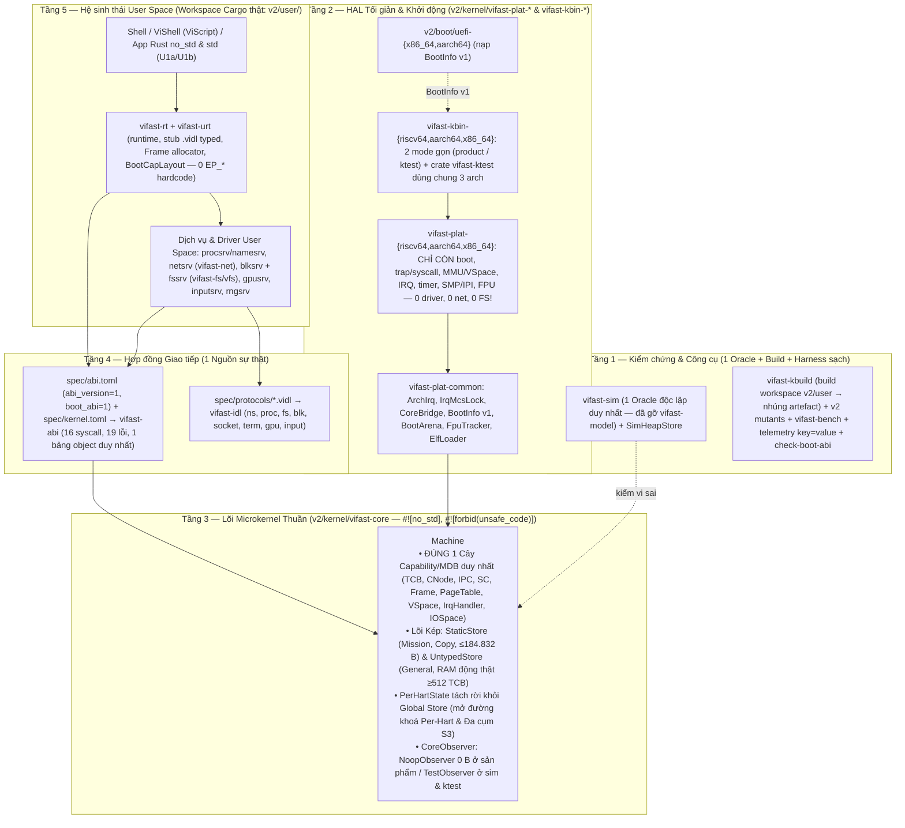

# KẾ HOẠCH ĐẠI TU & PHÁT TRIỂN KIẾN TRÚC VIFASTOS (`KT-400..KT-424`, 42 task ≤ 3 h — cập nhật `D2-261`)

**Người ban hành**: **Agent 0** (theo chỉ đạo trực tiếp của người điều phối, **D2-259** `2026-11-24`, hiệu đính **D2-260** `2026-11-25` & **D2-261** `2026-11-26`).
**Trạng thái**: **HIỆU LỰC NGAY — KẾ HOẠCH DUY NHẤT ĐANG CHẠY** (**29/42 `DONE`** — Chặng 0 & Chặng 1 xong 100 %; **3 `READY`** Đợt `W7a`; **10 `BLOCKED`** thuần theo DAG; **0 chờ duyệt**). Toàn bộ các kế hoạch phát hành trước đây (`v2.0`, `v2.1`, `KT-348`, Chu kỳ 2/3 cũ) đã được **huỷ bỏ hoàn toàn** và lưu trữ tại `v2/agent/archive/reports/`.
**Nguồn sự thật**: [`AGENTS.md`](AGENTS.md), [`v2/AGENTS.md`](v2/AGENTS.md), [`docs/QUYET-DINH-sau-review.md`](docs/QUYET-DINH-sau-review.md), [`v2/agent/DECISIONS.md`](v2/agent/DECISIONS.md) (**D2-259**, **D2-260**, **D2-261**), [`v2/agent/QUEUE.md`](v2/agent/QUEUE.md).
**Nhãn số liệu (QD §2.2 & §9 Q12)**: mọi hằng số thiết kế/ngân sách trong kế hoạch này mang nhãn `[TK]` (mặc định), giả thuyết `[GT]`, ước lượng `[ƯL]`; tuyệt đối không chứa số đo hiệu năng viết tay (mọi số đo chỉ dẫn từ nhật ký máy đo trong `v2/agent/JOURNAL/`).

> **Tuyên ngôn chỉ đạo (`D2-259`, cập nhật `D2-261`)**: **Bỏ toàn bộ áp lực phát hành (`v2.0` / `v2.1` / tag / báo cáo phát hành / soak nghìn boot trên nền cũ).** Tập trung **100 % vào tái cấu trúc và hoàn thiện kiến trúc Microkernel sạch, minh bạch, dễ mở rộng và dễ phát triển** — được phép refactor lại từ gốc miễn giữ vững kỷ luật kiểm chứng kỹ thuật (`T0`/`T1`/`T2`, test đỏ-trước, đột biến có răng, `forbid(unsafe_code)`, giữ cứng ratchet `B1.1`, không nới ngưỡng, không retry `D2-07`, không GitHub Actions `D2-241`, vận hành theo lịch giờ DeepSeek `D2-256`).

---

## 1. Kiến trúc Đích 5 tầng (Rõ ràng — 1 Nguồn sự thật — 0 Nhân bản)

Mọi task trong kế hoạch này đều phục vụ trực tiếp việc đưa cây mã về đúng **Kiến trúc Đích 5 tầng** dưới đây — chấm dứt dứt điểm **11 nút thắt** đã đo được trên mã nguồn:



### Bảng 11 nút thắt gốc & tiến độ giải quyết (cập nhật `D2-261`)

| # | Nút thắt gốc (đo trực tiếp từ mã nguồn) | Giải pháp đích trong kế hoạch | Trạng thái & Task |
|---|---|---|---|
| **1** | **2 Object/Capability Layer tách đôi trong kernel**: `vifast-core` (`[limits.core]`) vs `vifast-plat-common::obj` (`[limits.plat]`, 2.424 LOC / 33 caller) | Hợp nhất về **1 cây Capability/MDB duy nhất trong `vifast-core`** (`vifast-core/src/vm/` + `ArchVmOps`), xoá bảng thứ hai của `plat-common::obj` và xoá `[limits.plat]` | **`KT-416/416b` APPROVED → `KT-417` (READY) → `KT-417b`** |
| **2** | **Driver & dịch vụ phình trong kernel (`B1`)**: `3.567` LOC ở `kbin-riscv64` + 3 `plat-*` → `vifast-net` + 23 tệp driver | Giữ cứng ratchet `B1.1` (`≤ 23`, cấm tăng — kể cả `virtio-rng` đi User Space `rngsrv`), sau đó tách sạch **`netsrv` → `blksrv`/`fssrv` → `gpusrv`/`inputsrv`/`rngsrv`** ra User Space (`B1.2`) | **`KT-403` DONE → `KT-419/419b` → `KT-421..KT-423`** |
| **3** | **`v2/user/` chưa là workspace Cargo thật (`B4`) + nợ `N-7` P20 + `build.rs` lặp** | Cargo workspace thật (`clippy` + test trong `v2 check`), crate `vifast-kbuild`, 3 lockfile đồng bộ, máy kiểm `check-boot-abi.py`, đóng `N-7` P20 | **DONE (`KT-404`, `KT-404c`, `KT-404d`)** |
| **4** | **Trộn dữ liệu Oracle/Test vào `Machine`/`TcbData`** (`TcbData = 824 B > 512 B` ABI) | Tách `CoreObserver` (`NoopObserver` 0 B) + thân ABI in-place (`TcbCore ≤ 496 B`, `EndpointCore ≤ 48 B`) | **DONE (`KT-405`, `KT-408`)** |
| **5** | **Bảng tĩnh cố định khóa cứng `64 TCB / 256 Obj / 192 CNode slot`** | **Lõi Kép `Machine<S: KernelStore>`**: `StaticStore` (`Mission`, `Copy`, `≤ 184.832 B`) + `UntypedStore` (`General`, `BootArena`, `≥ 512 TCB / ≥ 1.024 Cap`) | **DONE (`KT-405`, `KT-408`, `KT-410`)** |
| **6** | **Big Kernel Lock (`IrqMcsLock<Machine>`) toàn cục cản SMP & IRQ** | Tách `PerHartState` + đo tranh khoá BKL 4 hart (`KT-415`: ngưỡng S3 đã kích hoạt ở 93,5 % tải bão hoà) + `Tier2Mailbox` | **Tiền đề DONE (`KT-405`, `KT-412..415`); khoá Per-Hart = #1 hậu `KT-424`** |
| **7** | **17 hằng số `EP_*` (+ 8 `SLOT_*`/`LOOP_*` + 2 mảng) hardcode rải rác giữa kernel & userland** | Sinh `BootCapLayout` từ `spec/abi.toml` `[boot_caps]` (`KT-417`), thay bằng layout tối giản (`SELF_TCB`, `SELF_CSPACE`, `NS_EP`) + `namesrv` + 6 `.vidl` (`KT-420`) | **`KT-404d` DONE → `KT-417` (READY) → `KT-420`** |
| **8** | **3 mô hình kernel song song (`B2`)**: `vifast-core`, `vifast-sim`, `vifast-model` | Đúng **2 thực thể**: `vifast-sim` (oracle độc lập) + `vifast-core` (sản phẩm) + `SimHeapStore`; **đã gỡ `vifast-model`** | **DONE (`KT-410`)** |
| **9** | **Test trong kernel phân mảnh (`B5`) & `kbin-riscv64` 14 `[[bin]]` (`32,7k` LOC)** | Crate `vifast-ktest` generic đa arch + gom `kbin-riscv64` 14 `[[bin]]` → 2 (`product`/`ktest` + 13 suite) + hợp nhất `smp_suite` 3 arch + gỡ 2.162 LOC `sched.rs` x64 | **`KT-411/411b/413b` DONE → `KT-413c` (READY)** |
| **10** | **HAL lặp + dev-dep ngược + Sv39/PLIC lẫn trong `plat-common` + `clippy` bỏ sót `v2/kernel/`** | Đưa `TableMemory`/Sv39 lên `vifast-pte`, dời RISC-V logic sang `vifast-plat-riscv64-logic`, gỡ dev-dep ngược, rút `IrqMcsLock`/`CoreBridge`, nối `clippy` kernel vào `v2 check` | **DONE (`KT-409`, `KT-409b`, `KT-411`)** |
| **11** | **Kho nặng rác v1 (~62 %), 3 `Cargo.lock` (`B3`), tooling ~53k LOC, 7 `E_WRONG-REASON` mutants** | Gỡ v1 + 2 tag archive, `check-lockfile-sync.py` 3 lockfile, `v2 mutants`, `telemetry.py`, `run-common.sh`, vá 7 `E_WRONG-REASON` + `Machine::now` `riscv64` | **`KT-400/403/407/404c/408b` DONE → `KT-408c` (READY)** |

---

## 2. Nguyên tắc vận hành cho chương trình Đại tu (không có gánh nặng phát hành)

1. **Tập trung kiến trúc, KHÔNG chạy soak phát hành lãng phí**: bỏ hoàn toàn `KT-348`, báo cáo `R2-v2`, tag `v2.0`/`v2.1` và các đợt soak nghìn boot trên nền kiến trúc cũ đang bị thay thế.
2. **Giữ vững kỷ luật an toàn khi refactor mạnh**:
   - Mọi task `≤ 3 h`, mã task `^KT-[0-9]+[a-z]?$` (`KT-400..KT-424`), **0 % chồng chéo tệp** giữa các slot chạy song song trong cùng một đợt.
   - Sub-agent chỉ chạy **T0 (`v2 t0`) + T1 (`v2 gate --dev`)** ở Giờ Thấp điểm DeepSeek (`0,5×`); Lead gom lô chạy **T2 (`v2 gate --fast`) + `L1-medium` + Miri + `v2 mutants --all` + `vifast-bench`** ở Giờ Cao điểm (`2×`, 0 token LLM, `D2-256`).
   - Không nới ngưỡng, không nới `b1.1-ratchet.toml` (`driver_files ≤ 23`, chỉ giảm), không retry `D2-07`, không GitHub Actions `D2-241`.
   - **Cửa sổ sửa `spec/` được Agent 0 cấp phép tường minh (`D2-261`, giữ `abi_version = 1`, `min_compat = 1`)**: chỉ `KT-417` (áp gói `D2-261`), `KT-417b` (xoá `[limits.plat]` & mở `PageTable.{Map,Unmap}`), `KT-417c` (`sysret_ready = true`), `KT-419` (`Irq*` + `Frame.{MapIo,UnmapIo}`), `KT-419b` (`IOSpace`), `KT-420` (mở `Tcb.Exec`). Mọi task khác cấm sửa `spec/`.

---

## 3. Đồ thị Sóng thi công 0 % chồng chéo tệp (`KT-400..KT-424` — 42 task, 4 Chặng, cập nhật `D2-261`)

```text
[CHƯƠNG TRÌNH ĐẠI TU KIẾN TRÚC VIFASTOS (D2-259 / D2-260 / D2-261)]
  │
  ═══════════════════════════════════════════════════════════════════════════════
  CHẶNG 0 — DỌN MẶT BẰNG, RATCHET & USER WORKSPACE         [DONE 100 % — 9/9 task]
  ═══════════════════════════════════════════════════════════════════════════════
  ✓ W1–W2: KT-400, KT-401, KT-401b, KT-402, KT-403, KT-404, KT-405, KT-406, KT-407
  │
  ═══════════════════════════════════════════════════════════════════════════════
  CHẶNG 1 — LÕI KÉP, HAL SẠCH, KTEST CHUNG & UEFI          [DONE 100 % — 12/12 task]
  ═══════════════════════════════════════════════════════════════════════════════
  ✓ W3–W4: KT-402b, KT-404c, KT-404d, KT-408, KT-408b, KT-409, KT-409b,
           KT-410, KT-411, KT-411b, KT-414, KT-414b
  │
  ═══════════════════════════════════════════════════════════════════════════════
  CHẶNG 2 — SMP 4 HART 3 ARCH, 1 CÂY CAP DUY NHẤT & ABI SẠCH [8 DONE / 3 READY / 3 BLOCKED]
  ═══════════════════════════════════════════════════════════════════════════════
  ✓ W5–W6: KT-412, KT-413, KT-413b, KT-415, KT-416 (APPROVED), KT-416b (APPROVED),
           KT-418, KT-418b (T2 PASS 81/81 @ bdf5c61)
  │
  ▼ ĐỢT W7a [READY NGAY — Thấp điểm 0,5× | 3 Slot song song | 0 % chồng tệp]
  ├── [Slot 1 — P0 ĐƯỜNG GĂNG]  KT-417  [READY] (Cửa sổ spec/ D2-261 giữ abi_version=1 + vifast-gen [boot_caps] + Tcb.{Bind,Unbind}Notification & CNode.{Mutate,Rotate})
  ├── [Slot 2 — P1 Dọn x64]     KT-413c [READY] (Gỡ trọn 2.162 LOC sched.rs x86_64 → Machine::dispatch + 24 mục # sched: đã duyệt D2-261; +64 KiB .bss)
  └── [Slot 3 — P1 Công cụ/Đo]  KT-408c [READY] (Vá 7 E_WRONG-REASON v2 mutants + tick Machine::now riscv64 + 5 SLOT_EP_* netsrv + Lead vifast-bench --bkl)
        └──► [Cao điểm: Lead merge + T2 + v2 mutants --all (kỳ vọng 100 % KILLED)]
  │
  ▼ ĐỢT W7b [Thấp điểm 0,5× | 2 Slot song song | 0 % chồng tệp]
  ├── [Slot 1 — P0 ĐƯỜNG GĂNG]  KT-417b (Hợp nhất 1 Cây Cap/MDB: dời 2.424 LOC plat-common::obj → vifast-core/src/vm/ + ArchVmOps + PageTable.{Map,Unmap} + XOÁ [limits.plat])
  └── [Slot 2 — P1 Hardening]   KT-418c (Điều tra & vá lỗi -cpu max VSpace isolation TF=1 + script hardening-max.sh SMEP/SMAP/PAN — KHÔNG nới ratchet B1.1!)
        └──► [Cao điểm: Lead merge + T2 + L1-medium 40k + Miri]
  │
  ═══════════════════════════════════════════════════════════════════════════════
  CHẶNG 3 — MICROKERNEL ĐÚNG NGHĨA: ĐẨY SẠCH DRIVER & DỊCH VỤ RA USER SPACE (B1.2)
  ═══════════════════════════════════════════════════════════════════════════════
  ▼ ĐỢT W8a [Thấp điểm 0,5× | 3 Slot song song | 0 % chồng tệp]
  ├── [Slot 1 — P0 ĐƯỜNG GĂNG]  KT-419  (Driver Infra P1: IrqControl/IrqHandler → Notification + Frame.MapIo/UnmapIo 3 arch + ca âm #1 bỏ Ack ⇒ ĐỎ)
  ├── [Slot 2 — P0 User Space]  KT-420  (BootCapLayout tối giản bỏ 17 EP_* + namesrv + 6 .vidl + vifast-rt U1a-Full + Tcb.Exec(elf_frame) + # build: 3 arch)
  └── [Slot 3 — P1 x64 Fast]    KT-417c (x86_64 syscall/sysret + GDT planned giữ song song int 0x80 & 7C-r13 + sysret_ready=true)
        └──► [Cao điểm: Lead merge + T2]
  │
  ▼ ĐỢT W8b [Thấp điểm 0,5× | 1 Slot đường găng]
  └── [Slot 1 — P0 ĐƯỜNG GĂNG]  KT-419b (Driver Infra P2: IOSpace IOMMU cô lập DMA 3 arch qua virtio-iommu-pci dùng chung + trait IommuOps + ca âm #2 DMA ngoài bảng ⇒ chặn)
        └──► [Cao điểm: Lead merge + T2]
  │
  ▼ ĐỢT W9 [Thấp điểm 0,5× | 3 Slot song song | 0 % chồng tệp (Lead dọn Cargo.toml lúc merge)]
  ├── [Slot 1 — B1.2 Mạng]      KT-421  (Tách netsrv + virtio-net 100 % ra v2/user/ + TCP socket.vidl → GỠ vifast-net/net_svc/proc_net/tcp khỏi kernel; dep_edges 3→0!)
  ├── [Slot 2 — B1.2 Đĩa/FS]    KT-422  (Tách blksrv + fssrv 100 % ra v2/user/ qua blk.vidl/fs.vidl + IOSpace → GỠ proc_fs/virtio_blk/vifast-fs/vfs khỏi kernel!)
  └── [Slot 3 — B1.2 GPU/RNG]   KT-423  (Tách gpusrv + inputsrv + rngsrv [từ KT-418b] + PCIe MSI-X/NVMe ra User Space → GỠ sạch virtio_*/vifast-virtio; driver_files → 0!)
        └──► [Cao điểm: Lead merge + T2 + v2 mutants --all]
  │
  ▼ ĐỢT W10 [Thấp điểm + Cao điểm kiểm định kiến trúc — KHÔNG soak phát hành]
  └── [Chốt Kiến trúc Sạch]     KT-424  (Port ViShell/ViScript + PoC Rust std PAL U1b + Kiểm toán kiến trúc: T2 + L1-medium 40k 2 Store + Miri + v2 mutants + vifast-bench --bkl)
```

---

## 4. Bảng đặc tả chi tiết 42 task (`KT-400..KT-424`, mọi task ≤ 3 h)

### Chặng 0 & Chặng 1 — ĐÃ HOÀN TẤT 100 % (21/21 task `DONE`, T2 PASS 81/81)

- **Chặng 0 (`9/9 DONE`)**: `KT-400` (dọn kho/v1), `KT-401` (xả R1 + ELF 32 KiB + `NBSend` một luật + `.corespace` NOLOAD rv), `KT-401b` (W^X 4 KiB rv + `.corespace` NX 3 arch), `KT-402` (`BootInfo` v1 + DTB/ACPI), `KT-403` (ratchet `B1.1` + `v2 mutants` + telemetry + `vifast-trace` + `vifast-bench`), `KT-404` (`v2/user/` Cargo workspace + `vifast-kbuild` + `N-7` + 9 crate `forbid(unsafe_code)`), `KT-405` (`CoreObserver` + `PerHartState` + intrusive ready queue + `TcbCore`/`EndpointCore` + dọn clippy `vifast-core`), `KT-406` (UART RX IRQ 3 arch + `LD_PRELOAD`), `KT-407` (tooling + `run-common.sh` + vá `guard_selftest` case 9 + `B3` lockfile).
- **Chặng 1 (`12/12 DONE`)**: `KT-402b` (harness `a64 -dtb` + `x64 fw_cfg` + ca âm), `KT-404c` (3 lockfile + gom `build.rs` 698→534), `KT-404d` (`check-boot-abi.py` bước cổng 85), `KT-408` (`KernelStore` + `Machine<S,O>` + ring trace `.corespace`), `KT-408b` (`pmemsave` đầu-cuối + vá `#[used]` `RING` + 3 đột biến `mut-ring-*`), `KT-409`/`KT-409b` (đại tu HAL + `TableMemory`/Sv39 → `vifast-pte` + `vifast-plat-riscv64-logic` + nối `clippy` kernel vào `v2 check`), `KT-410` (`UntypedStore` + `BootArena` + `SimHeapStore` + gỡ `vifast-model` `B2`), `KT-411`/`KT-411b` (`vifast-ktest` generic + `IrqMcsLock<T,S>` chung + gom 14 `[[bin]]` → 2), `KT-414`/`KT-414b` (UEFI `x86_64` OVMF & `aarch64` AAVMF + `BootSource::Uefi`).

### Chặng 2 — SMP 4 Hart 3 Arch, Hợp nhất 1 Cây Capability Duy nhất & ABI Sạch (`8 DONE` + `6 task` còn lại)

- **Đã `DONE` trong Chặng 2 (`8 task`)**: `KT-412` (SMP 4 hart rv/a64), `KT-413`/`KT-413b` (SMP 4 hart x64 + đóng `N-3` + hợp nhất `smp_suite` 3 arch + `pcid.rs` mặc định tắt), `KT-415` (`Tier2Mailbox` + `OVERFLOW` + range shootdown 3 arch + đo BKL 4 hart), `KT-416`/`KT-416b` (RFC 8 nhóm + 8 khuyến nghị A/B + 8 đính chính — **APPROVED `D2-261`**), `KT-418`/`KT-418b` (FPU/SIMD eager theo TCB + `SUM`/`SMEP`/`SMAP`/`PAN` + `vifast-virtio::{rng,rngdev}` + `EntropyPool` + fuzz `vifast-net`).

| Mã | Ưu tiên | Task | Phụ thuộc | Ngân sách | Tiêu chí xong (DoD) & Ranh giới tệp (`D2-261`) |
|---|---|---|---|---|---|
| **KT-417** | P0 | **Cửa sổ `spec/` ABI Sạch (`abi_version = 1`) + `vifast-gen` `[boot_caps]` + Cài `Tcb.{Bind,Unbind}Notification` & `CNode.{Mutate,Rotate}`** | `KT-415, KT-416, KT-416b` | 3 h | **`READY` NGAY (APPROVED `D2-261`)**: (1) `spec/abi.toml` (giữ `abi_version = 1`, `min_compat = 1`): thêm `Tcb.Exec` = method 16 nhận cap **`Frame`** (`unsupported = true, install_at = "KT-420"`, **CẤM `VSpace.Map`**), thêm `[method_signature]` cho `Tcb.{Bind,Unbind}Notification`, `IrqControl.*`, `IrqHandler.*` (giữ `Irq*` `reserved`+`unsupported` tới `KT-419`), `PageTable.{Map,Unmap}` (`unsupported` tới `KT-417b`), `CNode.{Mutate,Rotate}` (`Mutate` nhận `rights?` đầy đủ), và `[boot_caps]` (`boot_abi = 1`, 2 bảng `[boot_caps.cspace]` + `[boot_caps.proc]`); (2) `spec/kernel.toml`: thêm `[profiles.mission]`, `[profiles.general]`, `[fpu]` (`BootArena` dùng `#text:`, không chép số đo tay); giữ tạm `[limits.plat]` & `sysret_ready = false`; (3) mở rộng `vifast-gen/gen.py` sinh `BootCapLayout` + `BOOT_CAPS_TEST`/`BOOT_CAPS_PRODUCT` + `docs/abi.md`, đồng bộ `check_abi.py` + `gen-check`; (4) cài dispatch thật trong `vifast-core/src/invoke.rs`: `Tcb.{Bind,Unbind}Notification` (13/14) & `CNode.{Mutate,Rotate}` (3/6, lật `invoke.rs:1128-1129`, giữ ca âm `7`); 0 chạm `plat-x86_64`/`kbin-x86_64`; T2 PASS. |
| **KT-413c** | P1 | **Gỡ trọn 2.162 LOC `sched.rs` `x86_64` → `Machine::dispatch(hart)` + 24 mục `# sched:` (`D2-261`)** | `KT-413b` | 3 h | **`READY` NGAY (APPROVED `D2-261` đổi 24 mục kỳ vọng)**: xoá `kbin-x86_64/src/sched.rs` (1.376 LOC) + `plat-x86_64/src/sched.rs` (786 LOC), trả lại 64 KiB `.bss`; chạy trên `Machine::dispatch(hart)`, giữ 50 TAP & đủ 12 ca âm (n..z) trên định dạng mới, tái dùng `# core smp:` của `smp_suite::run_x64`, thêm 1 đột biến `mut-dispatch-*`; giữ 2 profile `smp_suite` & giữ `CR4.PCIDE` mặc định TẮT tới `HW1`; 0 sửa `spec/`, 0 chạm `rv`/`a64`; T2 PASS. |
| **KT-408c** | P1 | **Vá 7 `E_WRONG-REASON` `v2 mutants --all` + Tick `Machine::now` `riscv64` + 5 `SLOT_EP_*` `netsrv` + `vifast-bench --bkl`** | `KT-408b, KT-404d, KT-415` | 2,5 h | **`READY` NGAY (`D2-261`)**: (1) `v2/tools/mutants.py` tạo git tree tạm sau khi áp đột biến trong bản sao để 5 mục `ktest-riscv64` qua `rev-gate` thật + thêm `marker` ngân sách cho `mut-big-bss`/`mut-pt-bss` trong `v2/test/mutants.toml` ⇒ 7 mục cũ chuyển `KILLED`; (2) cấp tick đơn điệu cho `Machine::now` trên `riscv64` (`plat-riscv64/src/core_bridge.rs`, `pmemsave-ring.sh` ghi `t_ns` tăng thật); (3) mở rộng `check-boot-abi.py` canh 5 `SLOT_EP_*` của `netsrv_prod.rs` ↔ `proc_net.rs:174-184`; (4) Lead nối `--bkl` vào `v2/bin/vifast-bench` (`D2-253`); 0 sửa `spec/`, 0 chạm `x86_64`; T2 PASS. |
| **KT-417b** | P0 | **Hợp nhất 1 Cây Capability/MDB duy nhất (Dời 2.424 LOC `plat-common::obj` → `vifast-core` + Xoá `[limits.plat]`) & Cài `PageTable.{Map,Unmap}`** | `KT-417` | 3 h | (1) Dời `plat-common/src/obj/{mod,vspace,check,arena}.rs` (2.424 LOC, 33 caller) sang `vifast-core/src/vm/` (tránh trùng tên `MAX_OBJECTS` với `machine.rs`) và hợp nhất toàn bộ `Frame`/`PageTable`/`VSpace` vào 1 cây Capability/MDB duy nhất của `Machine` qua `ArchVmOps`; xoá bảng thứ hai của `plat-common::obj` & `core_foreign.rs`; (2) cài `PageTable.{Map,Unmap}` thật (gỡ `unsupported` trong `spec/abi.toml` + `check_abi.py`); (3) **xoá `[limits.plat]` khỏi `spec/kernel.toml` + sửa `check_kernel.py:277` & `--selftest`**; (4) chứng minh `CNode.Revoke` 1 `Untyped` thu hồi đồng thời `TCB` + `VSpace` + `Frame` (`size_of::<Machine>()` ≤ `184.832` B); T2 PASS. |
| **KT-418c** | P1 | **Điều tra & vá lỗi thật `-cpu max` `VSpace` isolation (`TF=1`) + Kịch bản hardening `-cpu max` (`SMEP`/`SMAP`/`PAN`)** | `KT-413c, KT-418b` | 2 h | **KHÔNG nới `b1.1-ratchet.toml`** (`virtio-rng` đi `rngsrv` User Space ở `KT-423`): (1) điều tra & vá lỗi có sẵn lộ ở `KT-418b` §6.4 (`ktest x86_64 -cpu max` dừng ở `# exc: vec=14 err=0x6 rflags=0x10202 [TF=1]`), kèm test đỏ-trước; (2) tạo kịch bản độc lập `v2/test/boot/hardening-max.sh` kiểm ca âm phần cứng `SMEP`/`SMAP` (`x64 -cpu max`) & `PAN` (`a64 -cpu max`) giữ nguyên baseline cổng cũ; 0 sửa `spec/`; T2 PASS. |
| **KT-417c** | P1 | **Bật `x86_64` `syscall`/`sysret` (`swapgs` + GDT `planned`, giữ song song `int 0x80` & `7C-r13`)** | `KT-417, KT-418c` | 3 h | Chạy song song Chặng 3 (0 chặn `KT-419..423`): (1) áp GDT `planned` (`user_data=0x18`, `user_code=0x20`, `STAR[63:48]=0x10`) + đường `syscall`/`sysret` (`swapgs` trên `asm/syscall.rs`, giữ `7C-r13`); (2) **giữ song song cổng `int 0x80`** (`min_compat = 1`, `mut-no-int80` còn ĐỎ) + TAP/ca âm cho `syscall`/`sysret`; (3) lật `sysret_ready = true` trong `spec/kernel.toml:87` + `check_kernel.py:395-396` + cập nhật selector `0x1b`/`0x23` trong `run-x86_64.sh`/`soak-x86_64.sh`; 0 chạm `asm/fpu.rs`; T2 PASS. |

### Chặng 3 — Microkernel Đúng nghĩa: Đẩy sạch Driver & Dịch vụ ra User Space (`B1.2`, Đợt W8a → W10, `7 task`)

| Mã | Ưu tiên | Task | Phụ thuộc | Ngân sách | Tiêu chí xong (DoD) & Ranh giới tệp (`D2-261`) |
|---|---|---|---|---|---|
| **KT-419** | P0 | **Nền tảng Driver U-mode P1: `IrqControl`/`IrqHandler` → `Notification` & `Frame.MapIo`/`UnmapIo` 3 arch** | `KT-417b` | 3 h | Nâng `IrqControl` (12)/`IrqHandler` (13) → `core` & gỡ `unsupported` cho `Irq*`/`Frame.{MapIo,UnmapIo}` trong `spec/abi.toml` (+ `check_reserved.py`/`check_abi.py`/`vifast-abi`); cài trọn vẹn `IrqControl`/`IrqHandler` → `Notification` & `Frame.MapIo`/`UnmapIo` (Device Untyped) trên 3 arch; **ca âm #1 bắt buộc**: bỏ `IrqHandler.Ack` ⇒ ngắt không tái phát (ĐỎ); T2 PASS. |
| **KT-419b** | P0 | **Nền tảng Driver U-mode P2: `IOSpace` IOMMU Cô lập DMA 3 arch qua `virtio-iommu-pci` dùng chung** | `KT-419` | 3 h | Nâng `IOSpace` (14) → `core` & gỡ `unsupported` cho `IOSpace.{Flush,Attach}` trong `spec/abi.toml`; cài trait `IommuOps` + driver chuẩn **`virtio-iommu-pci`** dùng chung 3 arch trên QEMU PCIe (`VIRTIO_F_ACCESS_PLATFORM`, VT-d/SMMUv3 vật lý chuyển `HW1`); **ca âm #2 bắt buộc**: thiết bị DMA ghi ngoài bảng trang `IOSpace` ⇒ bị chặn ngay với lỗi có tên; T2 PASS. |
| **KT-420** | P0 | **Kiến trúc User Space Sạch: `BootCapLayout` (bỏ 17 `EP_*`) + `namesrv` + 6 `.vidl` + `vifast-rt` `U1a-Full` + `Tcb.Exec(elf_frame)` + `# build:` 3 arch** | `KT-417b, KT-418b` | 3 h | Chạy song song `KT-419`: (1) thay 17 hằng `EP_*` hardcode bằng `BootCapLayout` tối giản (`SELF_TCB`, `SELF_CSPACE`, `NS_EP`) sinh từ `spec/abi.toml` + `namesrv`/`procsrv` cấp cap động + cập nhật `check-boot-abi.py`; (2) hoàn thiện 6 `.vidl` (`ns`, `proc`, `fs`, `blk`, `socket`, `term`) sinh stub `vifast-idl`; (3) nâng allocator `vifast-rt` cấp trang `Frame`/`Untyped` thật và cài thật **`Tcb.Exec(tcb, elf_frame, vspace)`** (method 16 nhận cap `Frame`, gỡ `unsupported`; `exec(path)` đọc tệp vào `Frame` ở User Space) trên 3 arch; (4) hoàn thiện `# build:` cho `aarch64`/`x86_64`; T2 PASS. |
| **KT-421** | P0 | **`B1.2` bước 1 — Tách `netsrv` + `virtio-net` 100 % ra User Space (`v2/user/`) & Gỡ `vifast-net` khỏi kernel** | `KT-419b, KT-420, KT-406` | 3 h | Chạy driver `virtio-net` (`Frame.MapIo` + `IrqHandler` + `IOSpace`) và toàn bộ ngăn xếp mạng `vifast-net` (DHCP/ARP/ICMP/UDP/DNS/TCP đầy đủ `socket.vidl`, `ping`/`ifconfig`) **100 % ở User Space**; **xóa sạch `net_svc.rs`, `proc_net.rs`, `virtio_net.rs`, `tcp.rs` (kèm nhánh chết `product-net` ở `riscv64/build.rs:206`) và gỡ dep `vifast-net` khỏi cả 3 `vifast-plat-*` và `vifast-kbin-*`**; siết ratchet `b1.1-ratchet.toml` (`dep_edges` 3→0, cấm tuyệt đối `vifast-net` trong kernel); T2 PASS. |
| **KT-422** | P0 | **`B1.2` bước 2 — Tách `blksrv` + `fssrv` (`virtio-blk` + `vifast-fs`/`vfs`) 100 % ra User Space & Gỡ khỏi kernel** | `KT-419b, KT-420` | 3 h | Chạy driver `virtio-blk` (`blksrv`, qua `Frame.MapIo` + `IrqHandler` + `IOSpace`) và hệ thống tệp `vifast-fs`/`vifast-vfs` (`fssrv`, qua `blk.vidl`/`fs.vidl`) **100 % ở User Space** (giữ đủ lệnh FS `ls`/`cat`/`write`/`mkdir`/`rm`/`mv`/`ln`/`fsck`/`df` & bền đĩa persist); **xóa sạch `proc_fs.rs`, `virtio_blk.rs` và gỡ `vifast-fs`/`vifast-vfs` khỏi kernel**; siết ratchet **cấm tuyệt đối FS/VFS trong kernel**; T2 PASS. |
| **KT-423** | P1 | **`B1.2` bước 3 — Tách `gpusrv` + `inputsrv` + `rngsrv` (`virtio-rng`) ra User Space + PCIe MSI-X/NVMe (Đích cuối `plat-*` 0 driver!)** | `KT-419b, KT-420` | 3 h | Chạy `virtio-gpu` (`gpusrv`, giữ PPM 23/23), `virtio-input` (`inputsrv`) và **`virtio-rng` (`rngsrv`, từ `vifast-virtio::{rng,rngdev}` của `KT-418b`)** 100 % ở User Space (`gpu.vidl`/`input.vidl`); thêm PCIe MSI-X + NVMe U-mode (`-device nvme`) trên `Frame.MapIo` + `IOSpace`; **gỡ sạch `virtio_*` & `vifast-virtio` khỏi `vifast-plat-*`** — đạt đích cuối: **`vifast-plat-*` chỉ còn `boot / trap / MMU / IRQ / timer / SMP / FPU`** (**siết ratchet `driver_files` về 0 vĩnh viễn!**); T2 PASS. |
| **KT-424** | P1 | **Hệ sinh thái Thực tế (`ViShell`/`ViScript` + PoC Rust `std` PAL `U1b`) & Kiểm toán Kiến trúc Chốt chặng** | `KT-414, KT-414b, KT-417c, KT-421, KT-422, KT-423` | 3 h | (1) Port & chạy tương tác thật `ViShell` (`ViScript`) trên `vifast-rt` + `.vidl` + kiểm chéo cục bộ `viscript-vifast.sh` (`D2-241`, 0 GitHub Actions); (2) chạy PoC ứng dụng Rust `std` (`U1b`: `thread`/`Mutex` trên `WaitAddr`, vDSO clock, `fs`, `stdout`); (3) **Kiểm toán kiến trúc sạch (KHÔNG soak phát hành)**: T2 PASS + `L1-medium` 40k (cả `StaticStore` & `UntypedStore`) + Miri + `v2 mutants --all` (100 % KILLED) + `vifast-bench --bkl` + kiểm tra 100 % bất biến đích (`driver_files = 0`, 1 cây MDB không còn `[limits.plat]`, 2 mô hình, `v2/user/` Cargo workspace thật, `plat-*` tối giản). |

---

## 5. Đường mở rộng dài hạn sau `KT-424` (khi kiến trúc đã vững tuyệt đối)

Nhờ kiến trúc 5 tầng sạch 100 % sau `KT-424`, mọi mở rộng về sau đều là plug-in hoặc server User Space — **không bao giờ phải refactor lõi hay phá vỡ ABI lần nữa**:
1. **Ưu tiên #1 hậu `KT-424` — Hiệu năng & Đa cụm (`S3` / `F1`, ĐÃ KÍCH HOẠT NGƯỠNG bởi `KT-415`)**: `bench-bkl` (`v2/agent/JOURNAL/kt415-smp-tier2.md`) đã đo tranh chấp Big Kernel Lock bão hoà **39,6 % ở 2 hart và 92,7–93,5 % ở 4 hart** — vượt xa ngưỡng 10 %. Ngay sau khi `KT-424` chốt nền 0 driver trong kernel: tách khoá theo `PerHartState` (đã cách ly sẵn từ `KT-405`), nối `HartTier2` (`KT-415`) vào đường IPI nóng 3 arch, mở rộng đa cụm L3/NUMA (`Machine<UntypedStore>` theo cụm) và thêm `ipc_fastpath` `F1`.
2. **Phần cứng vật lý thật (`HW1`)**: nối bước nhảy `e_entry` UEFI (`KT-414`/`414b`), cài backend IOMMU vật lý Intel VT-d (`x86_64`) & ARM SMMUv3 (`aarch64`) sau trait `IommuOps` (`KT-419b`), bật `CR4.PCIDE` + `INVPCID` theo PCID trên CPU hỗ trợ thật (`KT-413b`), thay hàm trộn `EntropyPool` bằng ChaCha20 mật mã (`KT-418b`), boot `ViFastOs-General` qua USB UEFI (NVMe + xHCI USB + GOP) và `ViFastOs-Mission` (`StaticStore` + TMR-ready) cho nhúng an toàn cao.
3. **Ảo hóa (`VCpu` `H1..H2`) & Desktop (`G1..G5`)**: mở `VCpu` + `VSpace` khách (Linux guest), Compositor U-mode, `ViTerm`, bộ gõ `ViFastKey`, và âm thanh thời gian thực — và chỉ khi mọi thứ thật sự ổn định mới bàn tới kế hoạch đóng gói/phát hành.
